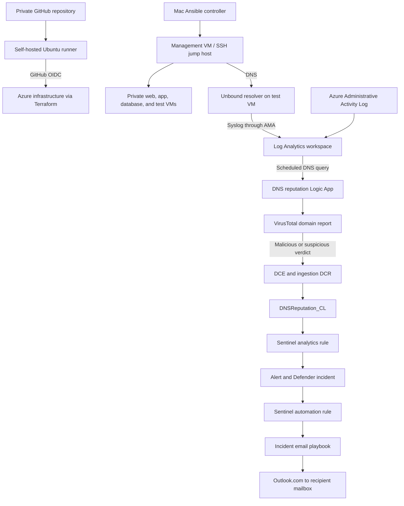

# Azure Infrastructure & Security Lab

I built this lab to connect Azure infrastructure deployment with Linux administration, security monitoring, and incident response. Terraform provisions the environment, Ansible configures workloads, and Microsoft Sentinel turns Azure activity and Linux telemetry into investigations.

The main security workflow follows a DNS lookup from a Linux client through Unbound, Log Analytics, a VirusTotal reputation check, and a Sentinel analytics rule. A controlled test produced an alert and incident in Microsoft Defender with the queried domain and client IP as investigation entities. A separate incident-response playbook automatically delivered notifications to Gmail through an Outlook.com connection. DNS reputation, NSG changes, and invalid-user SSH failures have all been tested through incident creation and email delivery.

## Why I built this lab

I wanted to practice the complete path from deploying infrastructure to investigating activity on it. Creating VMs alone would not show whether I could administer them, restrict access, collect the right evidence, write a detection, and get the result to an analyst. I used this project to connect those tasks instead of treating Terraform, Linux, networking, and security monitoring as separate exercises.

The questions I worked through were practical: Can I reproduce a service configuration? Can I demonstrate both allowed and denied traffic? Which events belong in Azure Activity Logs versus guest Syslog? Can a failed SSH login or a DNS lookup become an actionable incident? Can the same response playbook notify me about several different detections?

This is an independently built learning lab, not a production deployment or a claim of enterprise operating experience. I used documentation, generated workflow definitions, and assisted troubleshooting to build and understand the integration. The evidence below shows the outcomes I tested; the mistakes section records where the first design did not work.

## Project at a glance

| Area | Technology / system | Demonstrated result |
| --- | --- | --- |
| Infrastructure as code | Terraform 1.16.4, AzureRM 5.0.0 | Five Ubuntu VMs, two peered VNets, subnets, NICs, and workload networking |
| State management | Azure Blob Storage, separate bootstrap resource group | Remote state with locking and restricted network access |
| Private administration | Management VM / SSH jump host | Private SSH access to workload VMs through management |
| Configuration management | Ansible, Nginx | Custom web page and a repeat run with zero changes |
| Network validation | NSGs, Network Watcher, live HTTP requests | Management-to-web access allowed; app-to-web access denied |
| CI/CD | GitHub Actions, self-hosted Ubuntu runner, Entra OIDC | Automatic plans on main pushes; manually dispatched apply of a reviewed saved plan |
| Telemetry | Azure Activity Log, AMA, Syslog DCR | Administrative activity and Linux logs collected in Log Analytics |
| DNS detection | Unbound, VirusTotal, Logic Apps, Logs Ingestion API | Flagged domain verdict stored in `DNSReputation_CL`; Sentinel alert and Defender incident verified |
| Response automation | Sentinel incident trigger, Logic Apps, Outlook.com | Automatic email delivery verified for DNS, NSG, and SSH incidents |

**Validated through October 15, 2026:** all three detection paths produced incidents and automatic email notifications. SSH validation used nonexistent usernames; the failed-password branch remains untested. The DNS workflow is deliberately restricted to `linkcoll.net` for deterministic testing and retains a one-domain loop limit. The tested Unbound Ansible role still needs to be synchronized from the Mac before the repository fully reproduces that component.

### Final validation results

| Controlled test | Evidence captured | End result |
| --- | --- | --- |
| Management requests the private web page | Network Watcher allow and successful HTTP response | Intended management access works |
| App VM requests the web page | Deny decision and HTTP timeout | Web-tier restriction enforced |
| Management queries the test resolver | UDP/TCP answers and parsed Syslog records | Client/domain telemetry reaches the workspace |
| DNS lookup with a flagged VT report | HTTP 204 ingestion and Defender alert with IP/domain entities | DNS incident and automatic email |
| Test NSG security-rule change | Security-rule write, NSG alert, and delivered notification | NSG incident and automatic email |
| Six invalid-user SSH connections to web | Six matching records, host/IP entities, and delivered notification | SSH incident and automatic email |

The email screenshots supplied during validation contain personal mailbox details and are retained outside the repository gallery. The corresponding playbook code, incident evidence, and observed delivery are described here without exposing those addresses.

## Architecture

| Network | Region | Workloads |
| --- | --- | --- |
| `10.50.0.0/16` — primary VNet | East US 2 | Management `10.50.1.4`, web `10.50.2.4`, app `10.50.3.4`, database `10.50.4.4` |
| `10.60.0.0/16` — secondary VNet | East US | Test VM / Unbound resolver `10.60.1.4` |

The VNets are peered. Management uses Unbound as its upstream DNS server; `resolvectl status` confirmed the active setting. Ubuntu's loopback DNS stub can answer cached requests without generating another Unbound query. The resolver must remain available while management depends on it.

## Why I made these design choices

| Choice | Reason in this lab | Tradeoff / boundary |
| --- | --- | --- |
| Terraform maps keyed by workload | Define VMs, subnets, and regional placement consistently without duplicating every resource | Renaming a resource address still needs state-aware migration; maps do not prevent all replacement mistakes |
| Separate state-storage bootstrap | Avoid tying the backend lifecycle to workload cleanup and separate state access from workload permissions | Backend firewall access must be restored out of band if the runner's IP changes |
| Two peered VNets across two regions | The original sizes and single-region layout exceeded subscription limits; four one-vCPU VMs plus a test VM in another region fitted the available quota | This was a quota workaround, not a high-availability or disaster-recovery design; cross-region dependencies add cost and failure modes |
| SSH jump host | Concentrate administrative entry on management and use private target addresses | The jump host is a dependency; workload NSGs still need deliberate source restrictions |
| Ansible after Terraform | Separate Azure resource provisioning from guest package/service configuration | A successful VM deployment does not prove its application or guest disk is configured |
| Existing Ubuntu self-hosted runner | Reuse a machine with the required tools and network access rather than add another always-on Azure VM | I must maintain the host, account permissions, tooling, and availability; a separate Unix user is not VM isolation |
| GitHub OIDC | Authenticate deployments without a long-lived Azure client secret | Federated subject, branch, tenant, and RBAC scope must match; the workflow still needs private inputs such as the VT key |
| Selected Syslog collection rather than performance counters | Focus this milestone on security events and understanding the collection path | No claim of full performance monitoring, EDR, or process-tree investigation |
| Unbound on the test VM | Produce a central DNS source with client IP, domain, record type, and time for a controlled client | Only management is configured to use it; caching and alternate DNS paths limit visibility |
| Separate reputation and response workflows | Check VT before creating a detection, then reuse a second playbook to notify on multiple incident types | More components and permissions than sending email directly from the DNS workflow |
| Custom verdict table and Sentinel analytics rule | Preserve queryable reputation evidence and create an alert-backed incident visible in Defender | Adds table/DCR/endpoint configuration and ingestion latency |
| Shared Outlook.com notification playbook | Use one tested response for DNS, NSG, and SSH without building a separate Google OAuth application | Interactive mailbox authorization and connection maintenance remain manual |

## What I built

### 1. Repeatable infrastructure and controlled administration

I separated the Terraform state-storage bootstrap from the workload deployment so state access and workload lifecycle can be managed independently. The workload environment contains five Ubuntu VMs across two VNets, including an attached database data disk. Guest disk initialization remains a follow-up task.

Workload administration uses private SSH paths through the management VM. This tests a jump-host access pattern without requiring public SSH access to every workload. Segmentation is demonstrated most fully on the web tier; broader east-west and outbound restrictions remain future work.

Infrastructure, state, and network-access evidence — expand screenshots

The storage account's selected-network configuration restricts backend data access. Terraform backend initialization and the visible state blob show that remote state was in use.

A post-deployment plan reported no changes at that milestone. This is evidence for that point in time, not a claim that the current in-progress branch is always drift-free.

Private workload access was tested through management.

Network Watcher evaluated management SSH as allowed and app-to-web SSH as denied.

Management can reach the web service through its explicit HTTP allow rule.

A live HTTP request from management returns the custom page; the corresponding request from the app VM times out under the web NSG policy.

**Related material:** [state bootstrap](docs/01-state-storage-bootstrap.md), [workload deployment](docs/04-workload-deployment.md), [web segmentation](docs/06-web-network-segmentation.md).

### 2. Linux workload configuration with Ansible

I used Ansible to install Nginx, enable the service, deploy a custom homepage, and check the local HTTP response. A repeated execution reported **5 OK, 0 changed, 0 failed**, demonstrating repeatable configuration.

The Unbound installation and resolver configuration were also tested from the Mac controller. That working role has not yet been synchronized into this checkout: `ansible/dns.yml` currently contains Nginx tasks despite its DNS-oriented name and should not be used to reproduce the resolver configuration.

Ansible and DNS resolver evidence — expand screenshots

The initial Nginx installation was followed by a repeat execution to check configuration convergence.

A private HTTP request confirmed application content, separately from package installation.

The Unbound configuration was validated before the service restart; the play completed without failed or unreachable hosts.

Management received DNS answers from Unbound over both UDP and TCP.

**Related material:** [Ansible web configuration](docs/05-ansible-web-configuration.md), [DNS and security automation](docs/10-dns-and-security-automation.md).

### 3. CI/CD with federated Azure authentication

A self-hosted runner on the existing Ubuntu machine executes GitHub Actions under a dedicated runner account. GitHub OIDC authenticates the workflow to Azure without a stored Azure client secret. Network access to the state account uses the runner's public outbound IP; remote access to the runner through Tailscale does not automatically change that outbound route.

Pushes to `main` generate a saved Terraform plan. Apply is a separate manual workflow that verifies the selected plan's source run, attempt, commit, and artifact integrity before applying it. Private variable inputs come from the `TERRAFORM_TFVARS` GitHub secret, not the ignored local tfvars file. The apply process uses manual dispatch; it does not claim an independent environment-reviewer approval gate.

CI runner, authentication, and initial Sentinel deployment evidence — expand screenshots

The self-hosted runner connected to GitHub and listened for jobs.

Sentinel onboarding was subsequently deployed using the reviewed-plan pipeline.

**Related material:** [CI/CD runbook](docs/09-cicd-runner.md), [plan workflow](.github/workflows/terraform-plan.yml), [workflow definitions](.github/workflows/).

### 4. Telemetry and Sentinel detections

Administrative Azure Activity Logs and selected Linux Syslog facilities are collected centrally. AMA and its Syslog DCR cover management, web, and the test resolver VM. Heartbeat and Syslog ingestion were verified; this is not a full endpoint detection or process-tree monitoring deployment.

| Detection | Evidence source | Detection behavior | Validation status |
| --- | --- | --- | --- |
| NSG configuration change | `AzureActivity` | Successful NSG/rule writes and rule deletion; actor, resource, operation, time, and correlation details | Restored; controlled rule change produced alert, incident, and automatic email |
| Repeated failed SSH authentication | `Syslog` | Five matching invalid-user or failed-password records per host/source IP within 30 minutes | Six invalid-user records produced incident and automatic email; password branch untested |
| DNS domain flagged by VirusTotal | `DNSReputation_CL` | At least one malicious or suspicious engine verdict | Alert and incident verified in Defender |

Log ingestion, NSG detection, and SSH incident evidence — expand screenshots

Initial monitoring resources completed deployment, then guest Syslog and administrative AzureActivity were queried separately. These establish different evidence sources: guest authentication events versus Azure resource-management operations.

The controlled NSG test added a rule named `TEST_ALERT`; the resulting alert identified `nsg-test`. This validated detection of a management operation, not a before/after exposure analysis.

For SSH, a diagnostic query showed both `Invalid user` and `Connection closed by invalid user` records. Only the former matched the detection, preventing the same connection from being counted twice through those two message types.

The final SSH incident maps the web host and management's private source IP. The delivered notification reported six matching records. The portal screenshot displays Defender incident 13 while the email uses Sentinel incident 15; read-only API inspection confirmed that these identify the same synchronized incident, not two separate test outcomes.

**Related material:** [initial monitoring](docs/07-initial-monitoring.md), [Sentinel configuration](Terraform/sentinel.tf), [DNS analytics rule and ingestion](Terraform/dns-reputation-alerts.tf).

### 5. DNS reputation enrichment and investigation

Unbound records the client IP and queried domain. The scheduled `dns-rep` Logic App queries recently ingested records, normalizes the domain, excludes specific observed monitoring hostnames, and retrieves an existing VirusTotal domain report. The connector response nests verdict counts under `data.attributes.last_analysis_stats`.

When a malicious or suspicious count exceeds zero, the workflow sends one record per client IP through a Data Collection Endpoint and ingestion DCR into `DNSReputation_CL`. The saved record retains original DNS timestamps, verdict counts, VT analysis time, and workflow run ID. A scheduled Sentinel rule creates an alert with IP/DNS entity mappings and investigation custom details, then an incident visible in Defender.

Verified DNS ingestion and Defender incident

The ingestion action returned **HTTP 204** for the controlled test, with **4 malicious** and **5 suspicious** verdicts. Subsequent table results confirmed the record was queryable.

The Defender incident contains a scheduled Sentinel alert, the domain, client IP `10.50.1.4`, and the original DNS request time in the investigation description.

The test used DNS resolution; it did not require visiting the flagged website. A DNS lookup and reputation verdict are investigation signals, not proof of a website visit, malware execution, or compromise.

**Related material:** [DNS workflow](Terraform/sentinel.tf), [verdict ingestion and analytics rule](Terraform/dns-reputation-alerts.tf), [implementation notes](docs/10-dns-and-security-automation.md).

### 6. Incident email response playbook

I created a separate `incident-email` Logic App with a Sentinel incident trigger and Outlook.com connection. It formats the incident number, title, severity, status, description, activity timestamps, and investigation link into an HTML email. A manual run first verified delivery to Gmail. Subsequent new DNS, NSG, and SSH incidents invoked the playbook automatically and delivered notifications, validating the automation rule as well as the mail action.

The automation rule in Terraform matches the DNS, SSH, and NSG analytics-rule IDs and invokes this playbook when a matching incident is created. Automatic invocation has been verified for all three detections. Existing incidents are not processed retroactively by the creation trigger.

Permissions have distinct purposes: the playbook identity has Sentinel Reader on the workspace, while Sentinel's service identity needs Automation Contributor on the playbook resource group. Outlook authorization is separate and uses an interactive account sign-in. The lab's email-delivery screenshot is not included because it exposes personal mailbox details.

**Related material:** [email playbook and automation rule](Terraform/incident-email.tf).

## Engineering lessons

- **Match the actual response shape.** Missing the VirusTotal `data` wrapper made property lookups return null; defaulting those values to zero concealed the mismatch until full runtime outputs were inspected.
- **Choose the detection path for the investigation portal.** Direct API incident creation succeeded but did not synchronize to Defender. Saving verdict evidence and using a Sentinel analytics rule produced the required alert/incident workflow.
- **Separate authorization from propagation.** The ingestion DCR requires Monitoring Metrics Publisher on the correct scope. A correct new assignment can still return 403 until permissions propagate.
- **Treat throttling explicitly.** A stalled domain loop was traced to VirusTotal HTTP 429 responses and retries. Quota handling and bounded retries remain to be implemented.
- **Preserve Terraform resource identity.** Renaming the NSG rule's Terraform label without a `moved` block caused deletion/recreation. Azure then rejected immediate reuse of its rule GUID. The rule was restored and retested; future address-only refactors need migration blocks and plan review.
- **Replan after partial applies.** A saved plan is no longer usable after another operation changes state. Generate a fresh plan and inspect all changes before retrying.

## Mistakes, troubleshooting, and what I learned

These were part of the build, not hypothetical risks. Several fixes required inspecting the actual API response or event instead of repeatedly retrying a deployment.

| Problem / mistake | How I investigated and corrected it | What I learned |
| --- | --- | --- |
| Original VM sizes could not deploy under regional quota and SKU restrictions | Inspected quota and subscription SKU availability; changed sizes and regional placement, then verified private connectivity | Available examples are not necessarily deployable in my subscription; capacity constraints should inform the design early |
| Azure services returned missing-provider-registration errors | Registered the required resource providers before retrying a fresh plan | Resource-group Contributor and subscription provider registration are different permissions |
| OIDC login failed on a casing mismatch | Compared the token's exact subject with the federated credential | Identity trust strings are case-sensitive; a visually similar repo/owner string can still fail |
| Pipeline could not read backend state from a changed network | Checked the runner's public egress IP and restored the storage firewall allow entry | Portal management access does not prove storage data-plane access; Tailscale remote access does not imply exit-node routing |
| Attempted to reuse a stale plan or encountered a retained lock | Checked whether an apply was active, recovered only after it stopped, and generated a fresh plan | State protection is intentional; disabling locking is not the right default response |
| VT connector creation stalled and failed | Compared the connector's actual parameter schema with the configured API-key field and corrected it to `api_key` | A display label in documentation is not always the underlying API parameter name |
| VT condition returned false despite positive verdicts | Added temporary Compose diagnostics and inspected full runtime output; corrected the missing `data` wrapper | A null-safe expression can hide a bad field path by substituting zero; unknown is not the same as clean |
| Direct incident creation succeeded but nothing appeared in Defender | Checked the Sentinel API response and documented synchronization limitation; moved to a verdict table plus analytics rule | An API success and the required user-visible outcome are different acceptance criteria |
| A domain loop stayed in progress | Inspected nested run repetitions through Azure's API and found VT HTTP 429 retries | Loop status does not identify the failing action; external quotas must be designed into enrichment |
| Ingestion returned 403 with an apparent role assignment | Compared exact DCR scope and current principal ID; checked assignment timing and retested after propagation | Correct role name alone is insufficient; principal, resource scope, token audience, and propagation all matter |
| NSG Terraform label rename caused deletion/recreation and a 409 on GUID reuse | Inspected the failed plan/apply and missing Azure rule; recovered with a fresh reviewed plan after the reuse restriction cleared | Local resource labels form Terraform state addresses; use `moved` for address-only renames before applying |
| Alert enrichment was rejected by the API | Reduced dynamic description placeholders to three and shortened a custom-detail key to 20 characters or less | Terraform validation does not enforce every service-side constraint; API errors are part of validation |
| SSH tests stopped at host-key verification | Verified web's existing server fingerprint and saved it on management before repeating invalid-user attempts | A Mac using ProxyJump and an SSH client running on management have different `known_hosts` files; no private-key copying was required |
| A manual SSH query returned no rows even though matching logs existed | Compared event and ingestion times; temporarily removed the five-minute ingestion filter only for investigation | A scheduled detection's processing window is not the same as an analyst's historical search window |
| Email action succeeded but the expected inbox was empty | Compared the authorized sender with the configured recipient, corrected the recipient, and verified actual Gmail receipt | Connector HTTP 200 proves request success, not that the intended person received the notification |
| Incident numbers differed between email and Defender | Compared Sentinel `incidentNumber` with `providerIncidentId` for the same incident resource | Integrated products can assign different identifiers to the same investigation |

I also learned to separate HCL from the JSON schemas embedded in `jsonencode()`: Terraform deploys the resources, ARM describes connection settings, and Logic Apps evaluates triggers/actions and expressions at runtime. I used the Microsoft connector documentation and workflow Code view to understand fields such as `runAfter`, `inputs`, and `connectionId` instead of treating them as Terraform language features.

## What I created at the end

The result is a working cloud security lab with an evidence trail from infrastructure to response:

1. **Deployment:** a private repository and federated runner provision the Azure environment through reviewed plans.
2. **Administration:** a management host provides private access to Linux workloads; Ansible configures the web service repeatably.
3. **Visibility:** Azure administrative events and selected guest logs reach the workspace; Unbound adds a controlled DNS telemetry source.
4. **Detection:** KQL rules turn NSG writes, repeated invalid-user SSH records, and flagged DNS reputation into alert-backed Defender incidents.
5. **Investigation:** alert descriptions, custom details, source IPs, domains, and host entities provide starting evidence for an analyst.
6. **Response:** one incident-triggered playbook delivers notifications for all three detections automatically.

What I can demonstrate is the ability to connect these components, test the result, explain the permissions and data flow, and troubleshoot failures across the layers. This does not claim a highly available SOC platform, comprehensive threat coverage, or production-ready enrichment throughput.

## Remaining improvements and honest limits

The core validation is complete; these are reproducibility and operational improvements rather than additional features needed to make the successful tests real:

- Synchronize the tested Unbound role from the Mac. The current `ansible/dns.yml` is not the resolver implementation.
- Keep the DNS test filter explicit: the deployed workflow selects `linkcoll.net` and one domain per run. Broader coverage needs caching, quota-aware pacing, bounded retries, and checkpoint/replay handling; removing the filter alone does not solve reliability.
- The failed-password branch of SSH detection is configured but untested; password authentication remains disabled. Six matching log records are not a universal guarantee of six unique authentication attempts.
- The five-minute ingestion filter is not durable deduplication or exactly-once processing. Missed runs and long delays need a recovery design.
- Complete guest data-disk configuration, broader workload segmentation, outbound policy, and any additional telemetry only if the next project scope calls for them.
- Clean up temporary NSG test rules, check a final reviewed plan, review repository history and screenshots, and confirm rotation of the VT credential exposed in earlier private plan output. The input is now marked sensitive, but that does not remove old copies from history/artifacts or encrypt Terraform state.

## Repository guide

| Path | Purpose |
| --- | --- |
| [bootstrap/](bootstrap/) | Separate state-storage infrastructure |
| [Terraform/](Terraform/) | Compute, networking, monitoring, detections, and Logic Apps |
| [ansible/](ansible/) | Workload playbooks; tested resolver role awaits synchronization |
| [.github/workflows/](.github/workflows/) | OIDC test, automatic plan, manually dispatched saved-plan apply |
| [scripts/ci/](scripts/ci/) | Plan review, provenance checks, and PR comment helpers |
| [docs/](docs/) | Deployment history, design decisions, troubleshooting, and runbooks |
| [screenshots/](screenshots/) | Evidence grouped by project stage |

Deployment history: [bootstrap](docs/01-state-storage-bootstrap.md) · [original plan](docs/02-workload-plan-review.md) · [deployment blockers](docs/03-deployment-blockers.md) · [workloads](docs/04-workload-deployment.md) · [repository readiness](docs/08-repository-readiness.md).

## Reproduction and operating boundaries

Use Terraform **1.16.4** and AzureRM **5.0.0**, the committed provider lockfile, and the sanitized variable examples. Create private inputs for your environment, bootstrap the remote backend, then review a workload plan before applying it. The monitoring and automation runbooks record the additional portal-managed IAM assignments and connector authorization steps. Update the CI variable secret whenever private local input values change.

The workflows intentionally run only for the private repository on `main`; copying this project to a public portfolio repository does not enable the Azure-connected runner automatically. Keep state, saved plans, API keys, OAuth tokens, SSH private keys, and real variable files out of Git. Review screenshots and Git history before publishing a public copy.

This remains a lab implementation. Five-minute ingestion filters reduce repeated processing but do not provide durable checkpoints or exactly-once delivery. The VT workflow checks existing reputation reports; it does not continuously rescan domains. Investigation timestamps distinguish the original DNS request from verdict ingestion. Email delivery is verified, but retries and incident correlation can still create notification duplicates under some conditions.

## Costs and cleanup

VMs, disks, Log Analytics/Sentinel ingestion, retention, and Logic App executions can incur charges. Workspace quotas are not hard spending caps. Budget and backup configuration files are currently placeholders.

Deallocate unused VMs with the resolver dependency in mind; DNS and telemetry coverage change when services are offline. Storage can continue to incur charges after VM deallocation. Keep validation NSGs unattached, preserve state and investigation evidence, and review a destruction plan before removing infrastructure.
