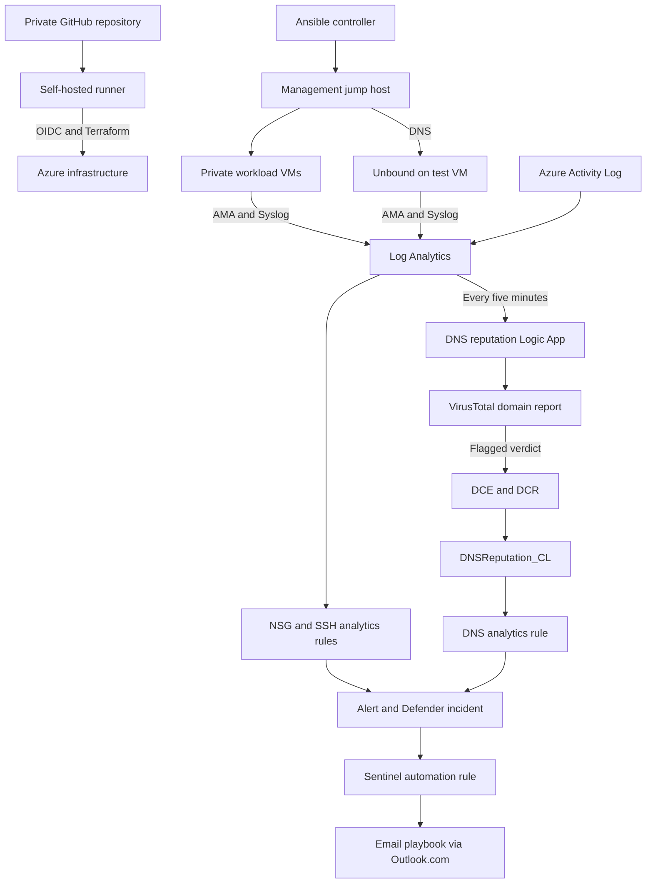
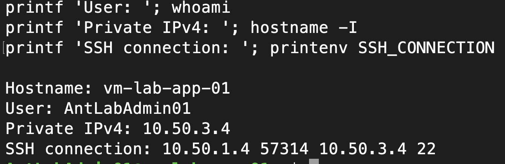
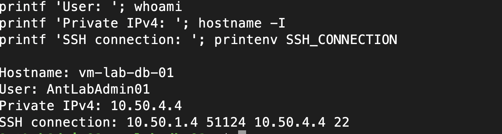
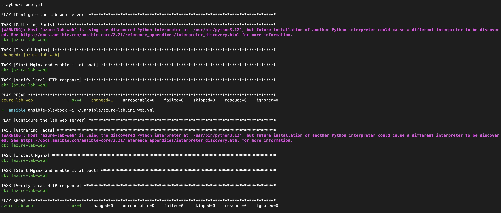
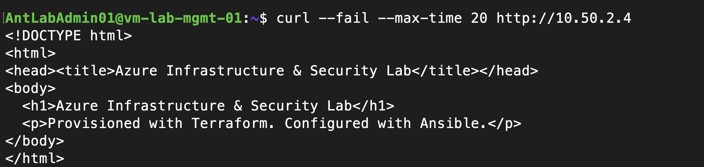
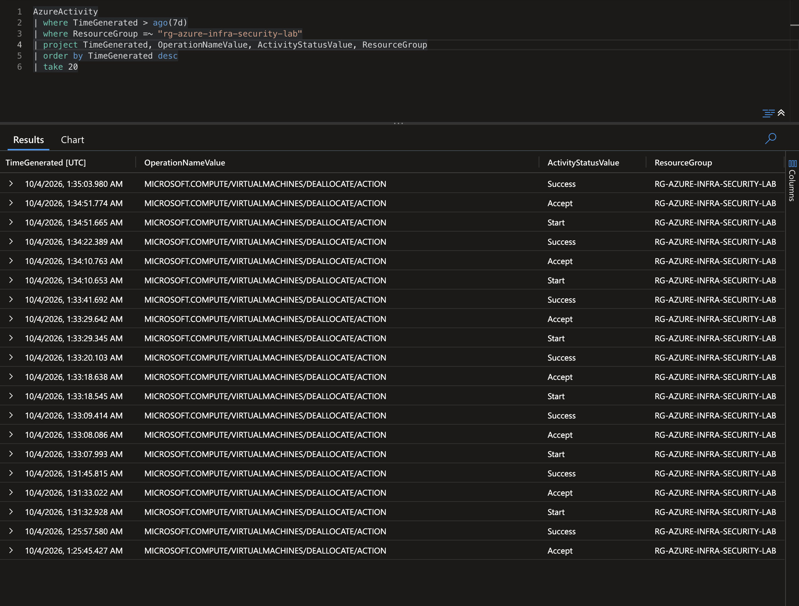
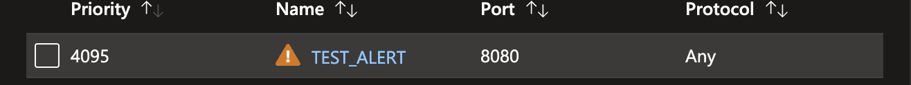

# Azure Infrastructure & Security Lab

**From Terraform deployment to a security incident in your inbox.**

 

I built this lab to practice the complete cloud security workflow: provision infrastructure, configure Linux services, restrict network access, collect logs, investigate activity, and automate notifications. It combines Terraform, Ansible, Azure Monitor, Microsoft Sentinel, and Logic Apps in a working Azure environment.

**Verified through October 15, 2026:** DNS reputation, NSG configuration changes, and repeated invalid-user SSH activity each produced an alert-backed Defender incident and an automatic email notification.

[Verified results](#verified-results) · [Architecture](#architecture) · [Build and evidence](#build-and-evidence) · [Lessons learned](#mistakes-and-what-i-learned) · [Getting started](#getting-started) · [Project structure](#project-structure)

## Features

- Five Ubuntu VMs across two peered VNets, with private workload access through a management jump host.
- Ansible configuration for Nginx and an Unbound DNS resolver.
- Azure Activity and Linux Syslog collection with three Sentinel detections.
- VirusTotal domain enrichment, a custom Log Analytics verdict table, and IP/domain entity mapping.
- A shared incident email playbook and GitHub Actions deployment using OIDC and reviewed saved plans.

## Tech Stack

| Area | Tools |
| --- | --- |
| Infrastructure and state | Terraform 1.16.4, AzureRM 5.0.0, Azure Blob Storage |
| Compute and networking | Ubuntu 24.04 LTS, Azure VMs, VNets, peering, NSGs, OpenSSH |
| Guest configuration | Ansible, YAML, Nginx, Unbound |
| Monitoring and detection | Azure Monitor Agent, DCR/DCE, Log Analytics, KQL, Microsoft Sentinel |
| Automation | Azure Logic Apps, VirusTotal, Outlook.com, managed identities |
| Deployment | GitHub Actions, Entra OIDC, Azure CLI, Bash, Python |

## Verified results

| Controlled test | Observed result | Evidence |
| --- | --- | --- |
| Management requests the private web page | HTTP succeeds; app-to-web traffic is denied | [Allow](screenshots/security/05-management-http-success.png) / [deny](screenshots/security/06-app-http-timeout.png) |
| Repeat the Nginx playbook | 5 OK, 0 changed, 0 failed | [Ansible recap](screenshots/ansible/03-custom-page-and-repeat-run.png) |
| Management queries Unbound | UDP/TCP DNS answers and query records in Syslog | [UDP](screenshots/dns/03-management-dns-udp.png) / [TCP](screenshots/dns/04-management-dns-tcp.png) |
| DNS lookup with a flagged VirusTotal report | Verdict ingested, alert and Defender incident created, email delivered | [DNS incident](screenshots/sentinel/02-dns-reputation-defender-incident.png) |
| Change a test NSG security rule | Configuration-change alert, incident, and email | [NSG alert](screenshots/sentinel/04-nsg-change-alert.png) |
| Six invalid-user SSH connections to web | Six matching records, host/IP entities, incident, and email | [SSH incident](screenshots/sentinel/03-ssh-failure-defender-incident.png) |

Email delivery was confirmed for all three detections. Email screenshots are kept outside the repository because they contain personal mailbox details. Expand the galleries below for the supporting deployment and investigation evidence.

## Architecture



| Network | Region | Workloads |
| --- | --- | --- |
| `10.50.0.0/16` | East US 2 | Management `10.50.1.4`, web `10.50.2.4`, app `10.50.3.4`, database `10.50.4.4` |
| `10.60.0.0/16` | East US | Test / Unbound `10.60.1.4` |

Management is the public SSH entry point. Other VMs use private addresses. Management also uses Unbound for DNS; only clients using that resolver are covered by the DNS detection.

## Why I made these choices

| Choice | Reason and tradeoff |
| --- | --- |
| Terraform for Azure, Ansible for Linux | Keep resource provisioning separate from packages, services, and configuration files. |
| Separate state bootstrap | Preserve state storage independently of workloads; backend firewall access still needs maintenance. |
| Two regions and smaller VMs | Work around subscription quota and SKU restrictions. This is not a high-availability design. |
| Management jump host | Centralize administrative entry and reach workloads privately; the jump host remains a dependency. |
| GitHub OIDC | Avoid a long-lived Azure client secret while retaining explicit repository, branch, and RBAC trust. |
| Unbound as a DNS source | Capture client IP, domain, and time in one place. Caching and alternate DNS paths limit visibility. |
| Verdict table plus Sentinel rule | Preserve queryable evidence and create alert-backed incidents visible in Defender. |
| One shared email playbook | Reuse the same response for DNS, SSH, and NSG incidents. |

## Build and evidence

### Infrastructure and network access

Terraform provisions five VMs, subnets, NICs, NSGs, peering, and a database data disk. Workload state uses an Azure Blob backend with restricted network access and state locking. Bootstrap has its own state.

I verified private SSH through management, a no-change Terraform plan after deployment, and web-tier restrictions using both Network Watcher and live HTTP requests. Management traffic succeeds; app-to-web traffic is denied.

<details>
<summary>View infrastructure and network tests</summary>







</details>

[Deployment history](docs/04-workload-deployment.md) · [Network segmentation](docs/06-web-network-segmentation.md)

### Linux configuration and DNS visibility

The Nginx playbook installs the service, deploys a custom page, checks HTTP, and produced zero changes on a repeat run. The original Unbound role installed and validated the resolver on test, allowed management as a client, forwarded to Azure DNS, and enabled Syslog query logging.

**Ansible source note:** the included Unbound role recreates the documented configuration. The original Mac-local version was tested live; the included recreation passes local checks and has not been deployed.

<details>
<summary>View Ansible recaps and UDP/TCP DNS tests</summary>






</details>

[Ansible setup and playbooks](ansible/README.md) · [DNS runbook](docs/10-dns-and-security-automation.md)

### Deployment pipeline and log collection

A self-hosted runner authenticates through GitHub OIDC. Pushes to private `main` generate a plan; a manually dispatched apply verifies the selected run, commit, lockfile, and saved-plan checksum. Apply is not automatic.

Azure Administrative Activity Logs and selected guest Syslog facilities reach Log Analytics. AMA covers management, web, and test. The initial general Syslog screenshot demonstrates ingestion, not the later SSH detection or a successful marker test.

<details>
<summary>View OIDC, runner, and log-ingestion evidence</summary>




</details>

[CI/CD runbook](docs/09-cicd-runner.md) · [Initial monitoring](docs/07-initial-monitoring.md)

### NSG configuration-change detection

A successful NSG or security-rule write/delete in Azure Activity triggers the scheduled detection. The alert includes the actor, operation, resource, and investigation details. A controlled `TEST_ALERT` security-rule change produced an incident and automatic email.

<details>
<summary>View the test rule and resulting alert</summary>




</details>

### Repeated SSH authentication failures

The Syslog rule groups matching records by host and source IP and triggers at five records within 30 minutes. I generated six invalid-user connections from management to web. The diagnostic query distinguished `Invalid user` records from the accompanying `Connection closed by invalid user` messages so those two message types were not counted twice.

The resulting incident maps the web host and management's private IP. The notification reported six matching records. Defender incident 13 and Sentinel incident 15 refer to the same synchronized incident; a read-only API check confirmed the mapping.

<details>
<summary>View SSH message matching and the incident</summary>


</details>

### DNS reputation and incident response

Every five minutes, the reputation Logic App queries recent Unbound records and retrieves an existing VirusTotal domain report. A malicious or suspicious verdict causes it to save the domain, client IP, verdict counts, original DNS times, and workflow run ID through the Logs Ingestion API.

A Sentinel rule queries `DNSReputation_CL` and creates the alert-backed incident. The controlled `linkcoll.net` test returned four malicious and five suspicious verdicts. HTTP 204 confirmed ingestion acceptance, and the resulting Defender incident showed the domain and client IP.

<details>
<summary>View successful ingestion and the DNS incident</summary>


</details>

The separate email playbook receives newly created incidents through a Sentinel automation rule. It formats the title, severity, description, activity times, and incident link into an HTML email. Automatic receipt was verified for DNS, NSG, and SSH.

[Detection definitions](Terraform/sentinel.tf) · [DNS table and rule](Terraform/dns-reputation-alerts.tf) · [Email playbook](Terraform/incident-email.tf) · [Automation runbook](docs/10-dns-and-security-automation.md)

## Mistakes and what I learned

| Problem | Fix and lesson |
| --- | --- |
| VM quota and SKU restrictions blocked deployment | Checked availability and adjusted sizes/regions before retrying. Example architectures must fit the subscription. |
| Missing provider registrations and an OIDC subject mismatch | Checked service registration and exact trust strings. Similar-looking identity settings are not interchangeable. |
| Backend access failed after the runner's network changed | Verified its actual egress IP. Portal management access does not prove Blob data access. |
| A saved plan became stale or state remained locked | Confirmed whether an apply was active, then generated a fresh plan. Locking protects state. |
| VT connector creation stalled | Checked the connector schema and corrected the API-key parameter to `api_key`. |
| Positive VT verdicts still evaluated false | Inspected runtime JSON and corrected the path to `data.attributes.last_analysis_stats`. A zero fallback can hide a missing field. |
| A domain loop stayed in progress | Inspected nested action repetitions and found HTTP 429 retries. Broader enrichment needs quota handling. |
| API-created incidents did not appear in Defender | Replaced direct creation with custom-table ingestion and a Sentinel analytics rule. API success must match the intended user outcome. |
| Ingestion returned 403 despite a role assignment | Checked the current principal, DCR scope, and propagation before retesting. |
| Renaming a Terraform resource caused recreation and GUID reuse errors | Restored the rule and retested. Resource-address refactors need `moved` blocks and plan review. |
| Sentinel rejected alert formatting | Reduced descriptions to three dynamic placeholders and shortened custom-detail keys to the service limit. |
| SSH stopped at host-key verification | Verified the server fingerprint and trusted it on management. The Mac and management have separate known-hosts files. |
| A later manual query returned no rows | Compared event and ingestion times. A five-minute processing window is different from a historical search. |
| Email succeeded but the inbox was empty | Corrected the recipient and checked actual delivery, rather than relying only on HTTP 200. |

I learned to trace failures across Terraform, Azure permissions, connector schemas, runtime JSON, KQL, and delivery. The final result is a working infrastructure-to-notification lab with evidence for each major stage.

## Getting Started

### Prerequisites

Use your own Azure subscription, available VM quota, Azure CLI, Git, Terraform **1.16.4**, Python 3, and an Ansible control node with OpenSSH. You also need a VirusTotal key and an Outlook.com mailbox. These resources incur Azure and API usage costs.

Bootstrap requires permission to create its resource groups, storage, and role assignment. Register the required Azure providers, including Logic and Web, and use the committed AzureRM **5.0.0** lockfiles. See the [deployment troubleshooting notes](docs/03-deployment-blockers.md).

### Installation

Clone the repository and create private input files:

```bash
git clone https://github.com/Anthonydeangelis/Azure-Infra-Security-Lab.git
cd Azure-Infra-Security-Lab
cp bootstrap/terraform.tfvars.example bootstrap/terraform.tfvars
cp Terraform/terraform.tfvars.example Terraform/terraform.tfvars
```

Replace every placeholder for your environment. Keep existing private files if already configured. Set the subscription, administrator IPs, SSH public key, resource names, `VTKey`, and `incident_email_recipient`. Never commit real tfvars or private keys.

Authenticate, initialize bootstrap, and create a plan:

```bash
az login
az account set --subscription "YOUR_SUBSCRIPTION_ID"
terraform -chdir=bootstrap init
terraform -chdir=bootstrap validate
terraform -chdir=bootstrap plan -out=bootstrap.tfplan
```

Review the plan before applying it:

```bash
terraform -chdir=bootstrap apply bootstrap.tfplan
```

Preserve bootstrap state separately. Update [backend.tf](Terraform/backend.tf) for your storage account; backend settings do not inherit tfvars. Allow the executing machine through the storage firewall and grant its identity Blob data access.

```bash
terraform -chdir=Terraform init
terraform -chdir=Terraform fmt -check -recursive
terraform -chdir=Terraform validate
terraform -chdir=Terraform plan -out=lab.tfplan
```

Review replacements, deletions, roles, and costs, then apply that exact plan:

```bash
terraform -chdir=Terraform apply lab.tfplan
```

Follow the [Ansible guide](ansible/README.md) for the private inventory and jump host. Complete the [portal-managed IAM and Outlook authorization](docs/10-dns-and-security-automation.md) steps. For CI, update the private `TERRAFORM_TFVARS` secret when inputs change; GitHub cannot read your ignored local file. Avoid concurrent local and CI applies.

### Local Usage

Run the playbooks from your configured control node:

```bash
ansible-playbook -i /path/to/private-inventory.ini ansible/web.yml
ansible-playbook -i /path/to/private-inventory.ini ansible/dns.yml
```

From management, test DNS and private HTTP using your deployment's addresses:

```bash
dig @10.60.1.4 example.com
dig +tcp @10.60.1.4 example.com
curl --fail --max-time 20 http://10.50.2.4
```

Inspect saved verdicts in the workspace Logs editor:

```kql
DNSReputation_CL
| where TimeGenerated > ago(1h)
| project TimeGenerated, Domain, ClientIP, MaliciousCount,
          SuspiciousCount, DNSFirstSeen, DNSLastSeen
| order by TimeGenerated desc
```

## Scope and remaining limits

- This is a learning lab. The DNS workflow deliberately checks **`linkcoll.net` only**, with one domain per run. It is not general production DNS coverage.
- DNS records show resolution activity, not full URLs, confirmed site visits, or proof of compromise. VT checks existing reports rather than performing a fresh scan.
- Caching, quota-aware pacing, bounded retries, and recovery/checkpoints remain follow-up work. Five-minute ingestion filters do not provide exactly-once processing.
- Invalid-user SSH detection was tested; the failed-password branch was not. Password authentication remains disabled.
- Web-tier segmentation was verified. Broader outbound policy, database engine/disk initialization, budget alerts, backup, and recovery tests are not implemented.
- NIC private allocation is dynamic; verify addresses before using fixed DNS or inventory settings. Management depends on the resolver remaining available.

The Azure-connected workflows require a private repository on `main`; public copies do not enable those jobs. State, saved plans, keys, OAuth tokens, and real input files remain private. See the [repository review](docs/08-repository-readiness.md) for the completed file/screenshot checks and remaining credential cleanup.

VMs, disks, logs, and workflow executions incur charges. Workspace quotas are not spending caps. When cleaning up, retain necessary evidence and state, review the destruction plan, and handle bootstrap separately. Deleting Azure resources does not invalidate external API credentials.

## Project Structure

```text
Azure-Infra-Security-Lab/
├── bootstrap/                  # State storage and initial resource groups
├── Terraform/
│   ├── variables.tf            # Workload inputs
│   ├── compute.tf              # VMs, disks, and AMA
│   ├── network.tf              # VNets, NSGs, peering, and NICs
│   ├── monitoring.tf           # Workspace and collection
│   ├── sentinel.tf             # NSG/SSH detections and VT workflow
│   ├── dns-reputation-alerts.tf # Verdict ingestion and DNS detection
│   └── incident-email.tf       # Notification playbook and automation rule
├── ansible/
│   ├── web.yml                 # Nginx configuration
│   ├── dns.yml                 # Resolver playbook
│   └── roles/unbound/          # Documented resolver configuration
├── .github/workflows/          # OIDC, plan, and reviewed-plan apply
├── scripts/ci/                 # Plan verification and comment helpers
├── docs/                       # Runbooks and troubleshooting history
└── screenshots/                # Evidence grouped by milestone
```

## Contributing

Open an issue or focused PR describing the problem, change, and validation. Use your own subscription for deployment tests and keep credentials, plans, state, and personal mailbox details out of commits.

Run Terraform formatting/validation and any relevant helper tests before submitting changes. Include a migration strategy for resource-address changes. Coordinate infrastructure applies and email tests with the environment owner.

## License

No license has been selected yet. A `LICENSE` file must be added before granting open-source reuse rights.

## Contact / Author

Built and documented by **Anthony DeAngelis**.

[GitHub profile](https://github.com/Anthonydeangelis) · [Project repository](https://github.com/Anthonydeangelis/Azure-Infra-Security-Lab) · [Hybrid Identity and Security Homelab](https://github.com/Anthonydeangelis/hybridhomelab)
