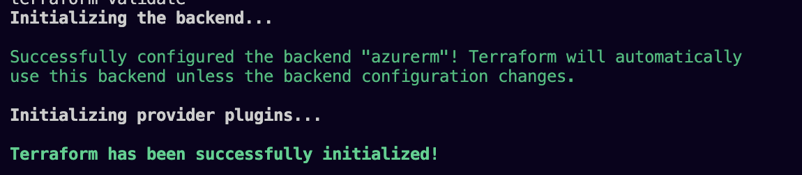
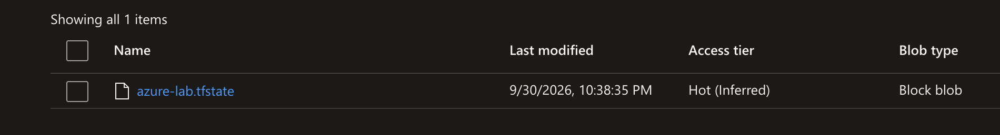

# Azure Infrastructure & Security Lab

A hands-on project demonstrating Azure administration, Terraform, and practical cloud security automation.

**The project story:** deploy a small Azure environment, secure it, collect its logs, detect a security-relevant change, and automate investigation and response.

## Current status

**State-storage bootstrap deployed; workload infrastructure still in progress.** User-provided screenshots show a successful Terraform apply creating a storage account and blob container, the storage account in its dedicated resource group, and public network access restricted to selected networks. Azure backend initialization succeeded and the `azure-lab.tfstate` blob is visible in storage. Remaining storage controls, workload deployment, monitoring, and automation are not yet verified.

See [Bootstrap deployment and evidence](docs/01-state-storage-bootstrap.md).

[Workload review](docs/02-workload-plan-review.md): validation passed and a plan proposed **30 new resources, no changes or deletions**. Workload deployment remains unverified; explicit outbound connectivity is still pending, and internal segmentation is deferred to the hardening phase.

[Deployment troubleshooting](docs/03-deployment-blockers.md): networking and the database data disk are tracked in state, but no workload VMs were found. VM deployment is blocked by four-vCPU regional quotas and restrictions on the original sizes. Smaller SKUs and a two-region layout are under evaluation.

Completed items will be checked off only after testing. Screenshots and short explanations will document the results, including any limitations.

**Design history:** the local Git tag `design-before-region-refactor` preserves the current code before the region-aware refactor, including an unfinished second-VNet block. [Original design, reason for the pivot, and checkpoint limitations](docs/03-deployment-blockers.md#design-history-checkpoint) are documented separately. The revised architecture remains planned.

## Planned architecture

```text
GitHub Actions + OIDC → Terraform → Azure lab resources
                                    ├── Virtual network, subnets, and NSGs
                                    ├── VM workload and managed identity
                                    ├── Storage and Key Vault
                                    └── Security controls and backup

Activity Log + selected resource/VM logs → Log Analytics
                                           ├── Azure Monitor alerts
                                           └── Microsoft Sentinel
                                                → Incident
                                                → Playbook enrichment + notification
```

The final design, region, resource sizes, access methods, and estimated costs will be recorded before deployment. Remote Terraform state will have its own documented setup and ownership.

## Project breakdown

### 1. Terraform infrastructure

**Goal:** deploy a small environment that can be reproduced and managed through code.

- [ ] Review the existing Terraform files and agree on the architecture.
- [ ] Define naming, tags, resource ownership, and remote state.
- [x] Deploy the bootstrap storage account and blob container.
- [x] Verify selected-network access is configured (exception details still pending).
- [x] Initialize the workload Azure backend and confirm the remote state blob exists.
- [ ] Deploy networking, five Linux VMs, workload storage, Key Vault, and managed identities.
- [ ] Configure GitHub Actions authentication with OIDC.
- [ ] Verify deployment and review a follow-up Terraform plan.

**Evidence:** architecture diagram, sanitized plan summary, deployed resources, and successful workflow run.

### 2. Secure administration

**Goal:** demonstrate controlled access, network protection, cost awareness, and recovery.

- [ ] Configure and test scoped RBAC assignments.
- [ ] Apply NSG rules and document the workload administration method.
- [ ] Configure appropriate private access for selected services.
- [ ] Apply Azure Policy and review compliance results.
- [ ] Configure a budget and alert notifications.
- [ ] Configure VM backup and complete a tested restore.

**Evidence:** allowed/denied access tests, network rules, policy results, budget configuration, and restore validation.

### 3. Operational monitoring

**Goal:** collect useful logs and demonstrate that monitoring works.

- [ ] Configure Log Analytics and subscription Activity Log export.
- [ ] Enable selected resource diagnostic settings.
- [ ] Configure Azure Monitor Agent and data collection rules where needed for VM logs.
- [ ] Save KQL queries for resource changes and workload health.
- [ ] Trigger and verify an operational alert.

**Evidence:** incoming log records, query results, and a tested alert.

### 4. Security monitoring

**Goal:** investigate an NSG change using Microsoft Sentinel.

- [ ] Enable Sentinel and verify the selected data sources.
- [ ] Create an isolated test NSG with no subnet or network interface attached.
- [ ] Generate a controlled rule change without exposing a workload.
- [ ] Create and test a detection that produces a Sentinel incident.
- [ ] Investigate the actor, resource, time, operation, and actual rule configuration.
- [ ] Test an expected change as well as a suspicious configuration.
- [ ] Remove the test rule and document the outcome.

**Evidence:** controlled event, Activity Log record, detection query, incident, and investigation walkthrough.

An NSG write is a change signal, not proof of dangerous access. The investigation will inspect rule direction, action, priority, source, destination, ports, and NSG associations. Current configuration may differ from the configuration at event time; that limitation will be recorded.

### 5. Investigation automation

**Goal:** enrich an incident and notify me using a Sentinel playbook.

- [ ] Document the playbook identity and minimum required permissions.
- [ ] Retrieve the affected NSG and its current rules and associations.
- [ ] Add investigation findings to the incident.
- [ ] Send and verify a notification.
- [ ] Test failure handling, including missing resources or denied access.

**Evidence:** playbook run, incident enrichment, notification, and a failure-handling test.

**Later, optional:** approval-required remediation restricted to explicitly tagged lab resources; scheduled shutdown of tagged VMs; or an inventory/compliance report. Automatic remediation is outside the initial scope.

## Repository layout

`bootstrap/`, `Terraform/`, `docs/`, and `screenshots/` exist. The monitoring, Sentinel, and automation folders are planned.

```text
bootstrap/     Separate state-storage creation configuration
Terraform/     Workload infrastructure code and configuration examples
monitoring/    KQL queries and operational alert definitions
sentinel/      Detection rules and investigation examples
automation/    Playbook definitions and supporting scripts
docs/          Architecture, decisions, permissions, costs, and troubleshooting
screenshots/   Sanitized evidence organized by phase
```

## Verified results

Evidence reviewed on 2026-10-01 from screenshots supplied by the project author. Screenshot filenames are dated 2026-09-30; the deployment's UTC timestamp was not independently verified.

| Step completed | Observed result | Evidence |
| --- | --- | --- |
| Bootstrap apply | Storage account and container created; **2 added, 0 changed, 0 destroyed** | [Apply evidence notes](docs/01-state-storage-bootstrap.md#1-terraform-apply) |
| Resource placement | Storage account visible in the dedicated state resource group, East US 2 | [Resource overview notes](docs/01-state-storage-bootstrap.md#2-resource-group-overview) |
| Storage network configuration | Selected networks enabled; one IPv4 entry and one exception displayed | [Networking screenshot](screenshots/bootstrap/03-storage-networking.png) |
| State-access RBAC | Role assignment apply: **1 added, 0 changed, 0 destroyed**; Storage Blob Data Contributor visible in IAM | [RBAC evidence notes](docs/01-state-storage-bootstrap.md#4-state-access-role-assignment) |
| Workload backend | Azure backend initialized successfully; `azure-lab.tfstate` block blob visible in the portal | [Remote-state evidence notes](docs/01-state-storage-bootstrap.md#5-workload-backend-initialization) |

### Remote-state evidence

Azure backend initialization completed successfully, and the state blob is visible in the storage container.





For each update, record **what changed, how it was tested, what happened, and a link to the evidence**. Include unsuccessful tests and their fixes when they demonstrate useful troubleshooting.

## Evidence and documentation

- Use descriptive screenshot names, such as `01-resource-overview.png` and `04-sentinel-incident.png`.
- Capture the configuration and its tested result; a setup screenshot alone does not prove success.
- Redact sensitive identifiers, account details, IP addresses where necessary, and notification recipients before committing evidence.
- Never commit credentials, private keys, Terraform state, saved plans, or private configuration. Review the repository exclusions before the first push.
- Keep detailed notes in `docs/` as needed and link to them from the completed phase.

## Costs and cleanup

Before deploying, document the region, VM size, expected runtime, log ingestion and retention, and estimated service costs. Review backup, Sentinel, private connectivity, and automation costs as each is introduced.

Budget alerts provide notification; they do not impose a hard spending limit. Record a shutdown and cleanup procedure, including resources that continue to incur charges after a VM is stopped. Protect state and retained evidence during cleanup.

## Project boundaries and related work

This lab builds on my previous Entra ID and Azure Automation work with PowerShell, Microsoft Graph, managed identities, Blob Storage, Key Vault, and GitHub Actions OIDC.

The Entra automation and Proxmox Terraform projects remain separate. Their resources will not be recreated or modified unnecessarily. Each managed resource must have one Terraform state owner; this project will not place an existing resource under a second state.

Links to those projects will be added when ready. Completion claims in this README apply only to evidence verified for this lab.
