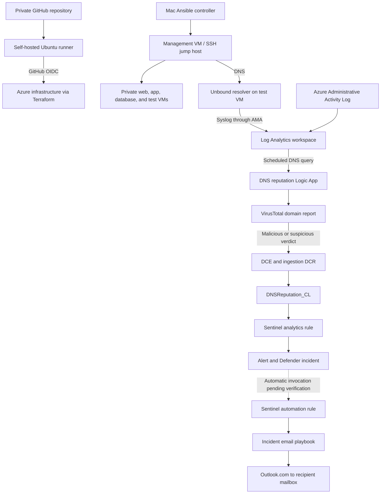
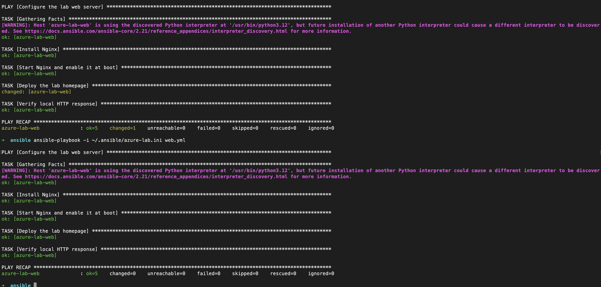
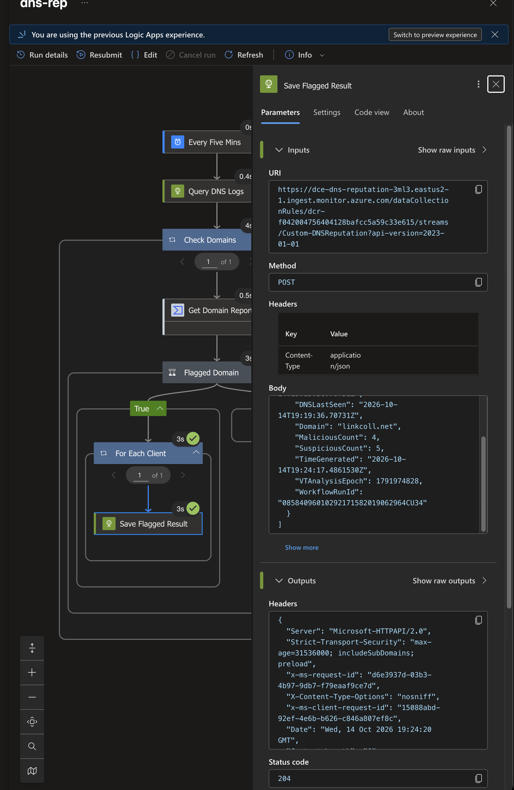
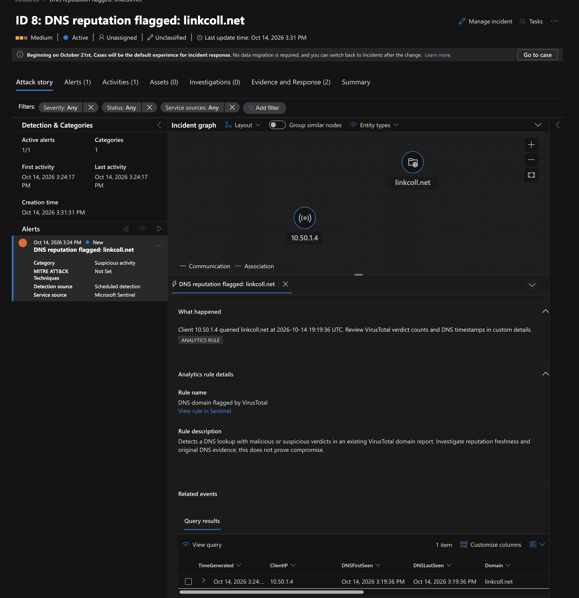

# Azure Infrastructure & Security Lab

I built this lab to connect Azure infrastructure deployment with Linux administration, security monitoring, and incident response. Terraform provisions the environment, Ansible configures workloads, and Microsoft Sentinel turns Azure activity and Linux telemetry into investigations.

The main security workflow follows a DNS lookup from a Linux client through Unbound, Log Analytics, a VirusTotal reputation check, and a Sentinel analytics rule. A controlled test produced an alert and incident in Microsoft Defender with the queried domain and client IP as investigation entities. A separate incident-response playbook successfully delivered an email notification to Gmail through an Outlook.com connection.

## Project at a glance

| Area | Technology / system | Demonstrated result |
| --- | --- | --- |
| Infrastructure as code | Terraform 1.16.4, AzureRM 5.0.0 | Five Ubuntu VMs, two peered VNets, subnets, NICs, and workload networking |
| State management | Azure Blob Storage, separate bootstrap resource group | Remote state with locking and restricted network access |
| Private administration | Management VM / SSH jump host | Private SSH access to workload VMs through management |
| Configuration management | Ansible, Nginx | Custom web page and a repeat run with zero changes |
| Network validation | NSGs, Network Watcher, live HTTP requests | Management-to-web access allowed; app-to-web access denied |
| CI/CD | GitHub Actions, self-hosted Ubuntu runner, Entra OIDC | Automatic plans on main pushes; manually dispatched apply of a reviewed saved plan |
| Telemetry | Azure Activity Log, AMA, Syslog DCR | Administrative activity and Linux logs collected in Log Analytics |
| DNS detection | Unbound, VirusTotal, Logic Apps, Logs Ingestion API | Flagged domain verdict stored in `DNSReputation_CL`; Sentinel alert and Defender incident verified |
| Response automation | Sentinel incident trigger, Logic Apps, Outlook.com | Manual incident playbook run delivered an email to Gmail |

**Current verification boundary:** DNS detection and manual email delivery are verified. Automatic email notification is configured in Terraform for DNS, SSH, and NSG incidents, but an automatic end-to-end test remains pending. The SSH rule still needs a verified test incident. The NSG detection previously worked and is currently awaiting restoration after a Terraform resource-label rename caused deletion and a temporary Azure rule-ID reuse conflict.

## Architecture

| Network | Region | Workloads |
| --- | --- | --- |
| `10.50.0.0/16` — primary VNet | East US 2 | Management `10.50.1.4`, web `10.50.2.4`, app `10.50.3.4`, database `10.50.4.4` |
| `10.60.0.0/16` — secondary VNet | East US | Test VM / Unbound resolver `10.60.1.4` |

The VNets are peered. Management uses Unbound as its upstream DNS server; `resolvectl status` confirmed the active setting. Ubuntu's loopback DNS stub can answer cached requests without generating another Unbound query. The resolver must remain available while management depends on it.

## What I built

### 1. Repeatable infrastructure and controlled administration

I separated the Terraform state-storage bootstrap from the workload deployment so state access and workload lifecycle can be managed independently. The workload environment contains five Ubuntu VMs across two VNets, including an attached database data disk. Guest disk initialization remains a follow-up task.

Workload administration uses private SSH paths through the management VM. This tests a jump-host access pattern without requiring public SSH access to every workload. Segmentation is demonstrated most fully on the web tier; broader east-west and outbound restrictions remain future work.

Infrastructure and network-access evidence

Management can reach the web service through its explicit HTTP allow rule.

A live HTTP request from management returns the custom page; the corresponding request from the app VM times out under the web NSG policy.

**Related material:** [state bootstrap](docs/01-state-storage-bootstrap.md), [workload deployment](docs/04-workload-deployment.md), [web segmentation](docs/06-web-network-segmentation.md).

### 2. Linux workload configuration with Ansible

I used Ansible to install Nginx, enable the service, deploy a custom homepage, and check the local HTTP response. A repeated execution reported **5 OK, 0 changed, 0 failed**, demonstrating repeatable configuration.

The Unbound installation and resolver configuration were also tested from the Mac controller. That working role has not yet been synchronized into this checkout: `ansible/dns.yml` currently contains Nginx tasks despite its DNS-oriented name and should not be used to reproduce the resolver configuration.

Ansible and DNS resolver evidence

The Unbound configuration was validated before the service restart; the play completed without failed or unreachable hosts.

Management received DNS answers from Unbound over both UDP and TCP.

**Related material:** [Ansible web configuration](docs/05-ansible-web-configuration.md), [DNS and security automation](docs/10-dns-and-security-automation.md).

### 3. CI/CD with federated Azure authentication

A self-hosted runner on the existing Ubuntu machine executes GitHub Actions under a dedicated runner account. GitHub OIDC authenticates the workflow to Azure without a stored Azure client secret. Network access to the state account uses the runner's public outbound IP; remote access to the runner through Tailscale does not automatically change that outbound route.

Pushes to `main` generate a saved Terraform plan. Apply is a separate manual workflow that verifies the selected plan's source run, attempt, commit, and artifact integrity before applying it. Private variable inputs come from the `TERRAFORM_TFVARS` GitHub secret, not the ignored local tfvars file. The apply process uses manual dispatch; it does not claim an independent environment-reviewer approval gate.

CI authentication evidence

**Related material:** [CI/CD runbook](docs/09-cicd-runner.md), [plan workflow](.github/workflows/terraform-plan.yml), [workflow definitions](.github/workflows/).

### 4. Telemetry and Sentinel detections

Administrative Azure Activity Logs and selected Linux Syslog facilities are collected centrally. AMA and its Syslog DCR cover management, web, and the test resolver VM. Heartbeat and Syslog ingestion were verified; this is not a full endpoint detection or process-tree monitoring deployment.

| Detection | Evidence source | Detection behavior | Validation status |
| --- | --- | --- | --- |
| NSG configuration change | `AzureActivity` | Successful NSG/rule writes and rule deletion; actor, resource, operation, time, and correlation details | Enriched incident previously verified; rule restoration pending |
| Repeated failed SSH authentication | `Syslog` | Five matching invalid-user or failed-password records per host/source IP within 30 minutes | Rule configured; end-to-end incident test remains open |
| DNS domain flagged by VirusTotal | `DNSReputation_CL` | At least one malicious or suspicious engine verdict | Alert and incident verified in Defender |

**Related material:** [initial monitoring](docs/07-initial-monitoring.md), [Sentinel configuration](Terraform/sentinel.tf), [DNS analytics rule and ingestion](Terraform/dns-reputation-alerts.tf).

### 5. DNS reputation enrichment and investigation

Unbound records the client IP and queried domain. The scheduled `dns-rep` Logic App queries recently ingested records, normalizes the domain, excludes specific observed monitoring hostnames, and retrieves an existing VirusTotal domain report. The connector response nests verdict counts under `data.attributes.last_analysis_stats`.

When a malicious or suspicious count exceeds zero, the workflow sends one record per client IP through a Data Collection Endpoint and ingestion DCR into `DNSReputation_CL`. The saved record retains original DNS timestamps, verdict counts, VT analysis time, and workflow run ID. A scheduled Sentinel rule creates an alert with IP/DNS entity mappings and investigation custom details, then an incident visible in Defender.

Verified DNS ingestion and Defender incident

The ingestion action returned **HTTP 204** for the controlled test, with **4 malicious** and **5 suspicious** verdicts. Subsequent table results confirmed the record was queryable.

The Defender incident contains a scheduled Sentinel alert, the domain, client IP `10.50.1.4`, and the original DNS request time in the investigation description.

The test used DNS resolution; it did not require visiting the flagged website. A DNS lookup and reputation verdict are investigation signals, not proof of a website visit, malware execution, or compromise.

**Related material:** [DNS workflow](Terraform/sentinel.tf), [verdict ingestion and analytics rule](Terraform/dns-reputation-alerts.tf), [implementation notes](docs/10-dns-and-security-automation.md).

### 6. Incident email response playbook

I created a separate `incident-email` Logic App with a Sentinel incident trigger and Outlook.com connection. It formats the incident number, title, severity, status, description, activity timestamps, and investigation link into an HTML email. A manual run from an incident succeeded and delivery to Gmail was confirmed.

The automation rule in Terraform matches the DNS, SSH, and NSG analytics-rule IDs and invokes this playbook when a matching incident is created. Automatic invocation still needs an end-to-end test after the current deployment recovery. Existing incidents are not processed retroactively by the creation trigger.

Permissions have distinct purposes: the playbook identity has Sentinel Reader on the workspace, while Sentinel's service identity needs Automation Contributor on the playbook resource group. Outlook authorization is separate and uses an interactive account sign-in. The lab's email-delivery screenshot is not included because it exposes personal mailbox details.

**Related material:** [email playbook and automation rule](Terraform/incident-email.tf).

## Engineering lessons

- **Match the actual response shape.** Missing the VirusTotal `data` wrapper made property lookups return null; defaulting those values to zero concealed the mismatch until full runtime outputs were inspected.
- **Choose the detection path for the investigation portal.** Direct API incident creation succeeded but did not synchronize to Defender. Saving verdict evidence and using a Sentinel analytics rule produced the required alert/incident workflow.
- **Separate authorization from propagation.** The ingestion DCR requires Monitoring Metrics Publisher on the correct scope. A correct new assignment can still return 403 until permissions propagate.
- **Treat throttling explicitly.** A stalled domain loop was traced to VirusTotal HTTP 429 responses and retries. Quota handling and bounded retries remain to be implemented.
- **Preserve Terraform resource identity.** Renaming the NSG rule's Terraform label without a `moved` block caused deletion/recreation. Azure then rejected immediate reuse of its rule GUID. Restoration is pending; future address-only refactors need migration blocks and plan review.
- **Replan after partial applies.** A saved plan is no longer usable after another operation changes state. Generate a fresh plan and inspect all changes before retrying.

## Remaining work

1. Restore the NSG analytics rule and verify its next test incident.
2. Verify automatic email invocation on a newly created matching incident.
3. Fix and validate the SSH detection; the failed-password branch remains untested with password authentication disabled.
4. Add VirusTotal quota handling, bounded retries, caching, and recovery for missed processing windows.
5. Replace the one-domain-per-run testing limit with controlled coverage. The current limit is not a queue and can skip other query results.
6. Synchronize the tested Unbound Ansible role into the repository.
7. Extend workload segmentation and outbound controls; complete guest data-disk setup and evaluate additional telemetry.

## Repository guide

| Path | Purpose |
| --- | --- |
| [bootstrap/](bootstrap/) | Separate state-storage infrastructure |
| [Terraform/](Terraform/) | Compute, networking, monitoring, detections, and Logic Apps |
| [ansible/](ansible/) | Workload playbooks; tested resolver role awaits synchronization |
| [.github/workflows/](.github/workflows/) | OIDC test, automatic plan, manually dispatched saved-plan apply |
| [scripts/ci/](scripts/ci/) | Plan review, provenance checks, and PR comment helpers |
| [docs/](docs/) | Deployment history, design decisions, troubleshooting, and runbooks |
| [screenshots/](screenshots/) | Evidence grouped by project stage |

Deployment history: [bootstrap](docs/01-state-storage-bootstrap.md) · [original plan](docs/02-workload-plan-review.md) · [deployment blockers](docs/03-deployment-blockers.md) · [workloads](docs/04-workload-deployment.md) · [repository readiness](docs/08-repository-readiness.md).

## Reproduction and operating boundaries

Use Terraform **1.16.4** and AzureRM **5.0.0**, the committed provider lockfile, and the sanitized variable examples. Create private inputs for your environment, bootstrap the remote backend, then review a workload plan before applying it. The monitoring and automation runbooks record the additional portal-managed IAM assignments and connector authorization steps. Update the CI variable secret whenever private local input values change.

The workflows intentionally run only for the private repository on `main`; copying this project to a public portfolio repository does not enable the Azure-connected runner automatically. Keep state, saved plans, API keys, OAuth tokens, SSH private keys, and real variable files out of Git. Review screenshots and Git history before publishing a public copy.

This remains a lab implementation. Five-minute ingestion filters reduce repeated processing but do not provide durable checkpoints or exactly-once delivery. The VT workflow checks existing reputation reports; it does not continuously rescan domains. Investigation timestamps distinguish the original DNS request from verdict ingestion. Email delivery is verified, but retries and incident correlation can still create notification duplicates under some conditions.

## Costs and cleanup

VMs, disks, Log Analytics/Sentinel ingestion, retention, and Logic App executions can incur charges. Workspace quotas are not hard spending caps. Budget and backup configuration files are currently placeholders.

Deallocate unused VMs with the resolver dependency in mind; DNS and telemetry coverage change when services are offline. Storage can continue to incur charges after VM deallocation. Keep validation NSGs unattached, preserve state and investigation evidence, and review a destruction plan before removing infrastructure.
