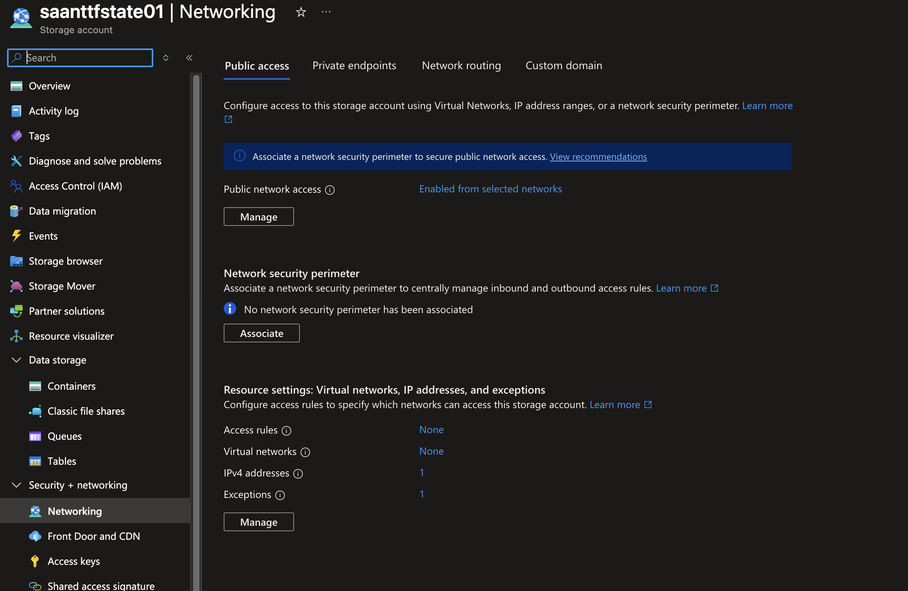
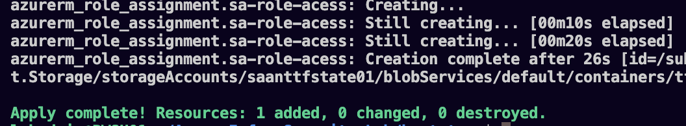
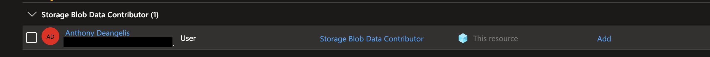

# State-storage bootstrap

## Purpose and scope

Create a dedicated Azure storage account and blob container for the future Terraform workload backend. Bootstrap and workload configurations have separate state ownership so workload cleanup does not remove the backend resources.

This milestone documents bootstrap deployment, successful workload backend initialization, and a visible remote state blob. The workload is using a fresh Azure backend; no Proxmox state migration is claimed. Terraform 1.16.4 was previously verified on the Ubuntu host. The exact AzureRM version used for this apply has not been verified from its lock file. No Azure queries, apply, or state changes were performed during this documentation update.

## 1. Terraform apply

The supplied terminal screenshot shows creation completing for `azurerm_storage_account.sa-tfstate` and `azurerm_storage_container.sa-tfstate-container`, followed by:

```text
Apply complete! Resources: 2 added, 0 changed, 0 destroyed.
```

This verifies the reported apply completed for those two resources. It does not prove this run created the resource group, configured RBAC, or wrote remote state.

**Image pending repository upload:** the screenshot named `Screenshot 2026-09-30 at 8.28.03 PM.png` was reviewed in chat, but its Mac-local file is not accessible from this Ubuntu workspace. Suggested repository filename: `screenshots/bootstrap/01-terraform-apply.png`.

## 2. Resource group overview

The supplied Azure portal screenshot shows storage account `saanttfstate01` in resource group `rg-tfstate-lab`, with East US 2 displayed for the group and account. The subscription ID is redacted.

This confirms the account's visible placement. The image does not establish how the resource group was created or show the blob container's access level.

**Image pending repository upload:** the screenshot named `Screenshot 2026-09-30 at 8.29.11 PM.png` was reviewed in chat, but its Mac-local file is not accessible from this Ubuntu workspace. Suggested repository filename: `screenshots/bootstrap/02-resource-group-overview.png`.

## 3. Storage network configuration



The portal shows:

- Public network access: **Enabled from selected networks**.
- IPv4 addresses: **1**.
- Virtual networks: **None**.
- Exceptions: **1**.
- No network security perimeter associated.

This verifies the displayed network configuration. The allowed IP and exception details are not shown, so this evidence does not establish that only the author's IP can access storage. Open **Manage** to inspect the exception and record whether it is intentional. Do not assume its type from the count alone.

An authenticated allowed/denied data-access test is still needed to verify enforcement. No public IP, credentials, or subscription ID is visible in the stored networking image.

## 4. State-access role assignment

The next Terraform apply completed with **1 added, 0 changed, 0 destroyed**, creating `azurerm_role_assignment.sa-role-access`. The visible resource path includes the storage account's blob container, supporting container-scoped assignment.

The portal screenshot displays **Storage Blob Data Contributor**, principal type **User**, and scope **This resource**. Together, the screenshots verify assignment creation and portal visibility. The cropped portal view does not independently identify the container, and neither image proves permissions have propagated or the workload backend has initialized successfully.

The project author approved showing the display name. The original screenshots are included below with their existing redactions preserved.





Subsequent backend initialization evidence is recorded below. Preserve bootstrap's local state and backup separately.

## 5. Workload backend initialization

The supplied terminal screenshot reports:

```text
Successfully configured the backend "azurerm"!
Terraform has been successfully initialized!
```

The Azure portal screenshot shows a block blob named `azure-lab.tfstate`. Its displayed last-modified value is **September 30, 2026, 10:38:35 PM**; the screenshot does not explicitly identify the portal timezone. The image also displays access tier **Hot (Inferred)**.

Together, these images support successful Azure backend setup and the presence of a remote state blob. They do not prove that the five VMs or networking have been deployed, that the state contains workload resources, or that concurrent locking and state recovery have been tested. The top edge of the terminal image includes text mentioning validation but does not show its result, so validation is not marked verified.


Next work: complete workload compute and networking code, validate it, review the deployment plan, and then apply the reviewed plan. Record compute and networking as completed only after successful deployment and verification.

## Remaining checks

- [ ] Inspect the single network exception and document the intended setting.
- [ ] Confirm Ubuntu's outbound address is allowed; allow the Mac separately if necessary.
- [ ] Verify anonymous blob access is disabled and HTTPS is required.
- [ ] Verify the container's private access level.
- [ ] Verify blob versioning and blob/container soft-delete retention.
- [x] Verify Storage Blob Data Contributor assignment creation and portal visibility (container scope supported by the apply resource path).
- [x] Verify the configured Terraform session can initialize the workload backend (identity linkage not independently queried).
- [ ] Preserve an encrypted, separate backup of bootstrap's local state.
- [x] Initialize the workload Azure backend and verify a remote state blob exists.
- [ ] Verify workload state contents and resource ownership after deployment without publishing state contents.
- [x] Add backend initialization and remote-state blob screenshots.
- [ ] Add initial apply and resource-group overview screenshots still available only through Mac-local paths.

## Troubleshooting recorded during bootstrap

| Observed issue | Guidance / result |
| --- | --- |
| Azure CLI executable not found | Install and authenticate Azure CLI on the Terraform host. Successful deployment is now evidenced; exact login steps are not shown. |
| Single IPv4 rule rejected with `/32` | Use a plain IPv4 address for a single storage firewall IP rule. The portal now shows one IPv4 entry. |
| `ResourceGroupNotFound` | Verify group existence and subscription; if creating the group in Terraform, reference the resource directly to establish ordering. The later screenshot proves successful storage creation, but the exact corrective action remains unconfirmed. |

## Evidence boundaries

Images were reviewed on 2026-10-01; their filenames carry 2026-09-30. Record a precise deployment timestamp only when confirmed. Keep source code as the configuration reference and screenshots as observed results. Do not publish private tfvars, state, saved plans, keys, or unredacted personal identifiers.
