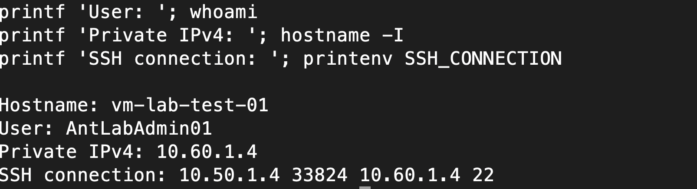
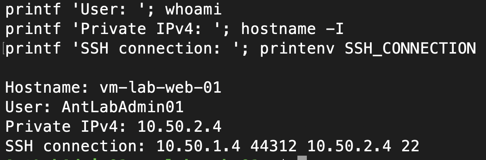

# Initial workload deployment verification

Evidence reviewed October 2, 2026 (America/New_York). Results below come from screenshots supplied by the author, not an independent live inventory check. Terraform context: 1.16.4, AzureRM 5.0.0, local Ubuntu execution and Azure Blob workload backend. This is a learning lab.

## Verified configuration

| VM | Region | Size |
| --- | --- | --- |
| vm-lab-mgmt-01 | eastus2 | Standard_F1as_v7 |
| vm-lab-web-01 | eastus2 | Standard_F1as_v7 |
| vm-lab-app-01 | eastus2 | Standard_F1as_v7 |
| vm-lab-db-01 | eastus2 | Standard_F1as_v7 |
| vm-lab-test-01 | eastus | Standard_F1as_v7 |

The test VM uses the same size as the others, rather than the earlier proposed Standard_F1als_v7. The inventory proves VM resources and configured sizes/locations; it does not establish guest health for every VM or application readiness.

| Check | Observed result | Screenshot supplied |
| --- | --- | --- |
| VM inventory | Five VMs with the placements above | 7.09.54 PM |
| VNet inventory | vnet-lab01: eastus2, 10.50.0.0/16; vnet-lab02: eastus, 10.60.0.0/16 | 7.10.02 PM |
| Primary-to-secondary peering | Connected; AllowVNetAccess True | 7.10.16 PM |
| Secondary-to-primary peering | Connected; AllowVNetAccess True | 7.10.35 PM |
| Database disk attachment | disk-lab-db-data, LUN 0, caching None | 7.10.44 PM |
| Management login | Author reports successful key-based SSH; screenshot shows Ubuntu 24.04.4 LTS, Azure kernel, private address 10.50.1.4 | 7.23.53 PM |

All screenshot filenames are dated 2026-10-02. The disk screenshot does not show a SizeGB column/value, so disk capacity is not verified by this evidence. Attachment also does not prove that the disk is formatted, mounted, or used by a database.

The login image does not show the SSH command or hostname/account checks. Stronger evidence should include `hostname`, `whoami`, and the OS version after login, with the public IP redacted.

## Screenshot files

The six images are visible in the conversation, but their supplied paths are on the Mac under `/Users/anthonydeangelis/Downloads/`. They are not accessible in this Ubuntu workspace. No copies or image links have been fabricated. Copy the sanitized files into `screenshots/workload/` using these names, then add repository links:

| Original screenshot time | Suggested repository filename |
| --- | --- |
| 7.09.54 PM | 01-vm-inventory.png |
| 7.10.02 PM | 02-vnet-inventory.png |
| 7.10.16 PM | 03-primary-peering.png |
| 7.10.35 PM | 04-secondary-peering.png |
| 7.10.44 PM | 05-database-disk-attachment.png |
| 7.23.53 PM | 06-management-ssh-login.png |

## Remaining verification and improvements

### Primary VNet SSH verified October 3, 2026

The supplied guest output identifies `vm-lab-app-01`, account `AntLabAdmin01`, and private address `10.50.3.4`. `SSH_CONNECTION` shows source `10.50.1.4` (management), source port 57314, destination `10.50.3.4`, and destination port 22. This verifies authenticated SSH from management to the app VM within the primary VNet. The image shows the last SSH hop; the author reports using ProxyJump from the Mac. It does not verify access to all private VMs or across peering.


#### Commands used (sanitized)

Run on the Mac to connect through the management jump host. `azure-lab-mgmt` is a local SSH configuration alias with the management public IP, administrator username, and key path; those private connection settings are not committed.

```bash
ssh -J azure-lab-mgmt -i ~/.ssh/KEY_FILENAME -o IdentitiesOnly=yes ADMIN_USERNAME@TARGET_PRIVATE_IP
```

Replace the placeholders locally. The target was the app VM for the verified test; use the test VM's private IP for the cross-region test. The private key stays on the Mac.

Run inside the destination VM to capture its identity and the last SSH hop:

```bash
printf '\nHostname: '; hostname
printf 'User: '; whoami
printf 'Private IPv4: '; hostname -I
printf 'SSH connection: '; printenv SSH_CONNECTION
```

These are the connection and verification commands used in the walkthrough, with connection values replaced by placeholders. Verification output should be reviewed before publication: redact public IPs and sensitive account identifiers. The screenshot retains lab-only private addresses as evidence of the tested path; the administrator account shown is a lab account, not a credential.

### Follow-up plan verified October 3, 2026

The author supplied a post-deployment Terraform plan screenshot reporting **"No changes. Your infrastructure matches the configuration."** This verifies that the normal plan found no pending changes for the managed configuration at that time. It does not verify application health, guest connectivity, or security controls beyond the attributes Terraform manages.


This screenshot is available in the repository; the six earlier Mac-only screenshots still need copying as described above.

### Cross-region SSH verified October 3, 2026

The supplied output identifies `vm-lab-test-01`, lab account `AntLabAdmin01`, and private address `10.60.1.4`. `SSH_CONNECTION` shows management source `10.50.1.4`, source port 33824, destination `10.60.1.4`, and destination port 22. Combined with the earlier region inventory, this verifies authenticated SSH from management in East US 2 to test in East US over the peered private networks. The author used the same sanitized ProxyJump and guest-verification commands documented above.



Verified destinations now include app, test, web, and database (see the additional evidence below). These tests do not establish traffic initiated in the reverse direction, application health, or denied-access behavior.

- Capture the actual successful apply summary; reviewed plan totals are not apply results.
- [x] Capture a normal follow-up `terraform plan` reporting no changes (October 3, 2026).
- [x] Verify management-to-app SSH within the primary VNet and management-to-test SSH across peering using ProxyJump, with destination identity and last-hop addresses captured.
- [x] Verify management-to-web and management-to-database SSH with destination identity and last-hop addresses captured. Management login was separately reported and evidenced by the Ubuntu login banner. Keep the private key on the Mac.
- Capture subnet placement and network access controls, including that only management has a public IP and its SSH rule is restricted to the intended source.
- Verify the database disk size, then format/mount it and test persistence before claiming usable database storage.
- Add explicit outbound connectivity through Terraform and test updates/package access on private VMs.
- Implement and test additional segmentation, allowed flows and denied flows.
- Proceed with scoped identities/RBAC, cost controls, backup/restore, monitoring, CI/CD, Sentinel and playbook phases. Those are not complete based on this evidence.

SSH troubleshooting: the author confirmed that the private-key-derived fingerprint matched Azure's configured public key. Login succeeded after explicitly selecting the key with `-i`, adding `IdentitiesOnly=yes`, and confirming the administrator username. The exact initial failure cause is not established because multiple connection inputs were checked.

## Validation and preservation

For the next infrastructure edit, run from `Terraform/`:

```bash
terraform fmt -check
terraform validate
terraform plan -out=lab.tfplan
```

Risks addressed: evidence accuracy, drift, secret exposure, and unintended replacement. Keep private inputs, saved plans and state out of Git. Preserve the Azure backend and database data; Git reverts restore code, not deleted Azure resources. No infrastructure or state changes were made while documenting these screenshots.

## Remaining private VM SSH paths verified October 3, 2026

The author supplied two additional guest-verification screenshots using the sanitized commands above:

| Destination | Private IPv4 | SSH source | Destination port | Result |
| --- | --- | --- | --- | --- |
| vm-lab-web-01 | 10.50.2.4 | 10.50.1.4 (management) | 22 | Authenticated as lab administrator |
| vm-lab-db-01 | 10.50.4.4 | 10.50.1.4 (management) | 22 | Authenticated as lab administrator |




Together with the app and cross-region test evidence, all four private VM destinations have verified SSH sessions from management. The author reports initiating these sessions from the Mac using ProxyJump; the guest screenshots establish the last hop. Outbound internet access and restrictive segmentation remain separate, pending tests.
