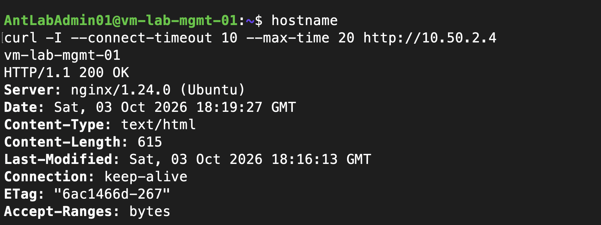

# Ansible web server configuration

Verified October 3, 2026 (America/New_York), from author-supplied terminal output and screenshots. The playbook is [web.yml](../ansible/web.yml). The Mac is the Ansible control node; management is the SSH jump host. Terraform continues to own Azure infrastructure, while Ansible configures the guest OS.

## Connection and execution

The local inventory at `~/.ansible/azure-lab.ini` contains:

```ini
[web]
azure-lab-web
```

The Mac's SSH configuration defines the alias with the web private address, administrator username, private-key path and `ProxyJump azure-lab-mgmt`. Connection settings, private keys and the live inventory remain outside the repository. No private key was copied to management or the target VM.

The author verified Ansible SSH/Python execution with `ping: pong` and privileged execution with `whoami` returning `root`. The command module reported CHANGED for that diagnostic command; it is not evidence of an actual configuration modification.

Commands run on the Mac, from the folder containing `web.yml`:

```bash
ansible web -i ~/.ansible/azure-lab.ini -m ansible.builtin.ping
ansible web -i ~/.ansible/azure-lab.ini --become -m ansible.builtin.command -a "whoami"
ansible-playbook -i ~/.ansible/azure-lab.ini web.yml --syntax-check
ansible-playbook -i ~/.ansible/azure-lab.ini web.yml
ansible-playbook -i ~/.ansible/azure-lab.ini web.yml
```

The author copied the playbook from the Ubuntu development machine to the Mac before running it. The sanitized transfer command is:

```bash
scp UBUNTU_USER@UBUNTU_ADDRESS:/home/labadmin/Azure-Infra-Security-Lab/ansible/web.yml ~/Azure-Infra-Security-Lab/ansible/
```

The repository is not yet synchronized through a GitHub remote; copies should be kept consistent until Git synchronization is established.

## Playbook behavior and verified results

The playbook targets only `web`, uses privilege escalation, installs Nginx with APT, ensures the service is started/enabled, and requires an HTTP 200 response from `http://127.0.0.1` on the target. Package metadata is refreshed when older than 3600 seconds. The local health check is separate from network reachability testing.

| Run | OK | Changed | Unreachable | Failed | Result |
| --- | ---: | ---: | ---: | ---: | --- |
| First | 4 | 1 | 0 | 0 | Nginx installed; service and local HTTP checks passed |
| Immediate repeat | 4 | 0 | 0 | 0 | No changes needed; demonstrates repeat-run idempotence |


Ansible emitted a Python interpreter discovery warning for `/usr/bin/python3.12`. Execution succeeded; this warning did not prevent configuration. Exact runtime version should be recorded with `ansible --version`; it has not yet been captured as a dedicated version check.

## Private HTTP reachability

Run inside management:

```bash
hostname
curl -I --connect-timeout 10 --max-time 20 http://10.50.2.4
```

Output identifies `vm-lab-mgmt-01` and returns `HTTP/1.1 200 OK` with `Server: nginx/1.24.0 (Ubuntu)`. This verifies management-to-web private HTTP reachability. It does not prove public exposure, HTTPS, access restrictions from other sources, or application/backend readiness.



Installation also demonstrates package retrieval succeeded on the web VM at that time. It does not verify explicit outbound configuration or outbound access on every VM.

## Custom homepage verified October 3, 2026

The repository playbook now includes `ansible.builtin.copy` to manage `/var/www/html/index.html`, owned by root with mode `0644`. The page identifies the Azure Infrastructure & Security Lab and states that infrastructure was provisioned with Terraform and configured with Ansible. The file change does not require a service restart for this static page.

| Run | OK | Changed | Unreachable | Failed |
| --- | ---: | ---: | ---: | ---: |
| Custom page deployment | 5 | 1 | 0 | 0 |
| Immediate repeat | 5 | 0 | 0 | 0 |


The author ran the same playbook command documented above. Inside management, the following command returned the expected custom HTML, including the lab title and Terraform/Ansible paragraph:

```bash
curl --fail --max-time 20 http://10.50.2.4
```


This adds content verification to the previous HTTP status check. Only the private management-to-web path is evidenced; public access, HTTPS and backend functionality are not claimed.

## Next work

- Record `ansible --version` and retain a reproducible control-node setup.
- [x] Deploy a custom lab page through Ansible, retrieve its content from management, and demonstrate no changes on the immediate repeat run.
- Configure the app/database roles separately when their design is agreed.
- Define explicit outbound connectivity and additional segmentation through Terraform; verify allowed and denied flows.
- Add CI validation and reviewed automation in later phases.

No infrastructure changes were performed while recording this evidence. Reverting the playbook in Git does not uninstall packages or undo guest configuration already applied.
