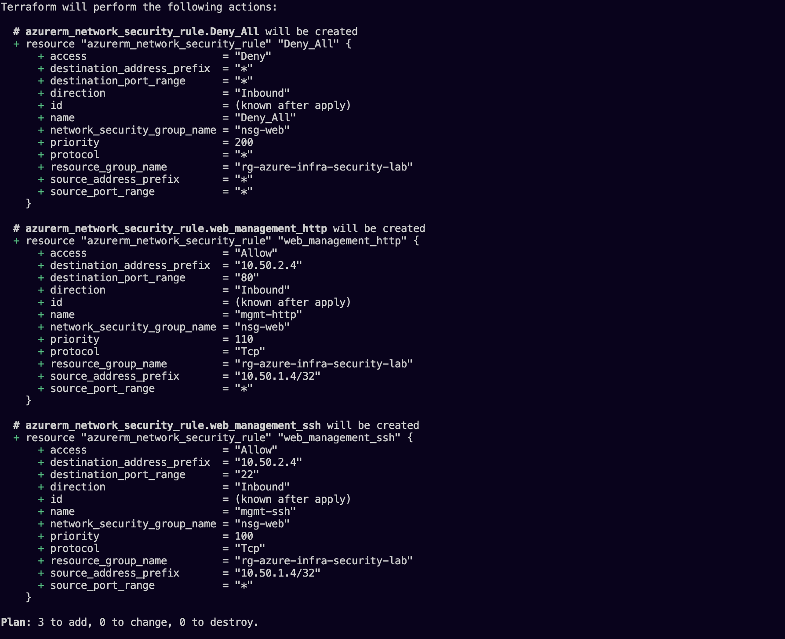
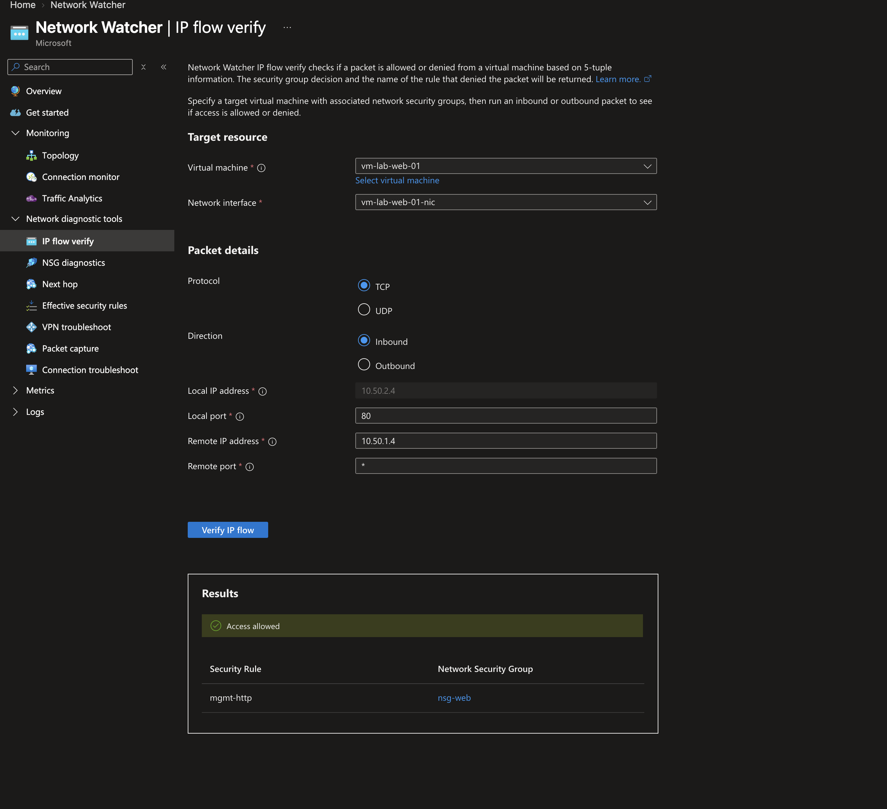
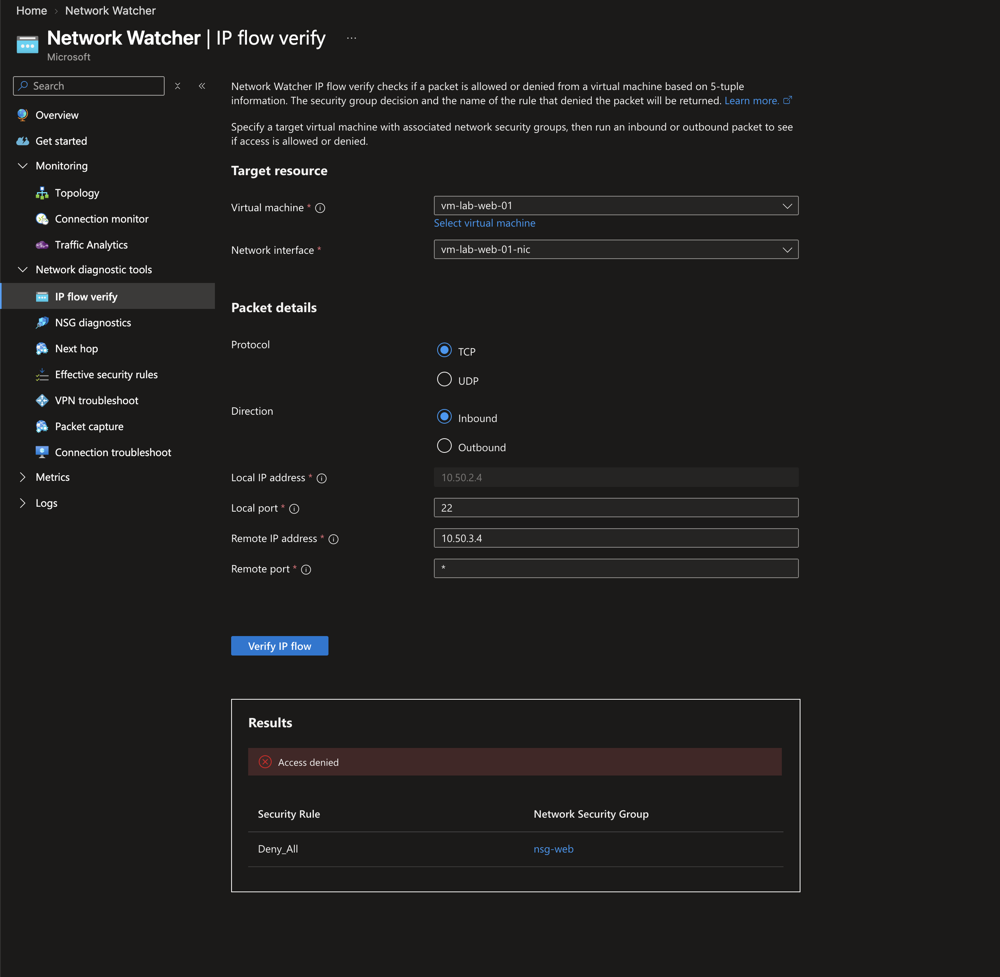
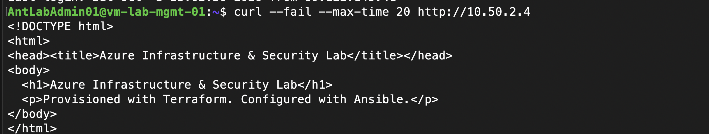
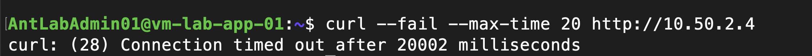

# Web subnet inbound segmentation

October 3, 2026 (America/New_York). **Status: Network Watcher rule decisions and live management/app HTTP tests evidenced. Fresh web SSH and follow-up no-changes plan confirmed by the author without screenshots. Apply summary remains uncaptured.** Context: Terraform 1.16.4, AzureRM 5.0.0, local Ubuntu execution, existing Azure Blob state, learning lab.

## Before and intended after

Previously, default NSG VirtualNetwork inbound access allowed broad connectivity from the local and peered VNets. Earlier screenshots verified management-to-web SSH and HTTP; a pre-change test-to-web HTTP baseline has not been captured.

The change adds three inbound rules to `nsg-web`, associated with the web subnet. Azure's default rules remain, but these custom priorities are evaluated first:

| Priority | Rule | Source | Destination | Protocol/port | Action |
| ---: | --- | --- | --- | --- | --- |
| 100 | mgmt-ssh | Management private IP, 10.50.1.4/32 | Web private IP, 10.50.2.4 | TCP 22 | Allow |
| 110 | mgmt-http | Management private IP, 10.50.1.4/32 | Web private IP, 10.50.2.4 | TCP 80 | Allow |
| 200 | Deny_All | Any | Any | Any | Deny |

This restricts inbound traffic covered by the web NSG while preserving the administration/test paths. Outbound rules and other subnet NSGs are unchanged. Single-host source matching is narrower than permitting the whole management subnet. The addresses are derived by Terraform resource references; dynamic address changes still require a reviewed plan to reconcile rules.

## Reviewed plan evidence

The author supplied a plan reporting **3 to add, 0 to change, 0 to destroy**. The three additions are the rules above; the screenshot shows TCP for both allows and the deny priority after them. It does not prove application of the rules.



Configuration: [network.tf](../Terraform/network.tf). Source/destination are lab-only private addresses; no credentials or public connection settings are included in this evidence.

## Apply and test walkthrough

Run from `Terraform/`, reviewing the current plan before applying:

```bash
terraform fmt -check
terraform validate
terraform plan -out=lab.tfplan
terraform apply lab.tfplan
```

Capture the apply summary and deployed rule inventory. Use fresh connections because NSGs are stateful and existing connections may persist after rule changes.

| Test | Expected result | Evidence status |
| --- | --- | --- |
| New management-to-web SSH session | Allowed | Author confirmed success; screenshot not supplied |
| Management-to-web HTTP | HTTP 200 and expected page | Expected page retrieved after change; earlier HTTP 200 and current Network Watcher allow corroborate access |
| Test-to-web HTTP | Blocked | Pending |
| Follow-up Terraform plan | No changes | Author confirmed no changes; screenshot not supplied |

Run inside management, then separately inside the test VM:

```bash
hostname
curl --fail --connect-timeout 10 --max-time 20 http://10.50.2.4
```

A test-VM timeout is consistent with blocking, but is not sufficient alone to identify the NSG as the cause. Pair it with successful management HTTP and the deployed rules; use Network Watcher IP flow verification if attribution is uncertain. Existing cross-region SSH evidence establishes the broader private path worked before this change.

## Risks and rollback

Risk: access interruption from incorrect source, port, or priority; incomplete evidence of enforcement. Only the web NSG is changed. Management's own public SSH rule remains unchanged in this plan.

If intended management access fails, inspect the rule values and correct them through Terraform. To undo this change, remove only these three rule declarations, review a plan showing their deletion, and apply that reviewed plan; the broader default inbound access will become effective again. Do not delete the NSG, subnet, VMs, or state to recover access. Git restores code history, not deployed behavior until a reviewed apply is performed.

## Network Watcher results verified October 3, 2026

Author-supplied IP flow verify results target `vm-lab-web-01` and its NIC. All tests are TCP inbound with local address `10.50.2.4`; the portal remote-port field displays `*`. These are NSG rule-decision checks, not live SSH sessions or HTTP requests.

| Source | Destination port | Decision | Matching rule |
| --- | ---: | --- | --- |
| Management, 10.50.1.4 | 80 | Allow | mgmt-http |
| Management, 10.50.1.4 | 22 | Allow | mgmt-ssh |
| App, 10.50.3.4 | 22 | Deny | Deny_All |
| App, 10.50.3.4 | 80 | Deny | Deny_All |






The fourth supplied screenshot verifies app HTTP denial but includes account details in the portal header. It was reviewed but not copied into the repository; a cropped/redacted replacement is needed before embedding it. The tested denied source is the app VM, not the East US test VM. Cross-region test-to-web denial remains unverified.

These results show the intended rules are effective in Azure for the evaluated inputs. They do not establish the exact apply resource counts, guest service health after the change, or a new SSH session succeeding. Next evidence: fresh management SSH and HTTP, a real blocked app/test HTTP request, and a normal follow-up Terraform plan. Earlier successful HTTP/SSH evidence predates this segmentation change.

## Live HTTP verification after segmentation

October 3 screenshots show the author running this command separately inside management and app:

```bash
curl --fail --max-time 20 http://10.50.2.4
```

- Management (`vm-lab-mgmt-01`) retrieved the expected custom lab HTML.
- App (`vm-lab-app-01`) returned curl error 28: connection timed out after 20002 milliseconds.





The simultaneous allowed source and denied source results, together with IP flow verify identifying `mgmt-http` and `Deny_All`, corroborate the intended HTTP restriction. The timeout by itself would not identify its cause. Test-to-web traffic across peering remains untested after this change; app-to-web denial is the verified negative case. Fresh management-to-web SSH and a follow-up no-changes plan were subsequently confirmed by the author without retained screenshots (see below). The actual apply summary remains uncaptured.

## Final checks reported by the author

On October 3, 2026, the author confirmed that a fresh web SSH session through management still succeeded and the follow-up Terraform plan reported no changes. These checks are recorded as author-confirmed results; screenshots and independent command output were not supplied. Network Watcher and live HTTP screenshots above remain the retained evidence for rule decisions and HTTP behavior. The actual apply summary is still not captured.
