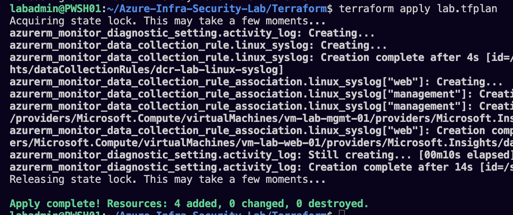
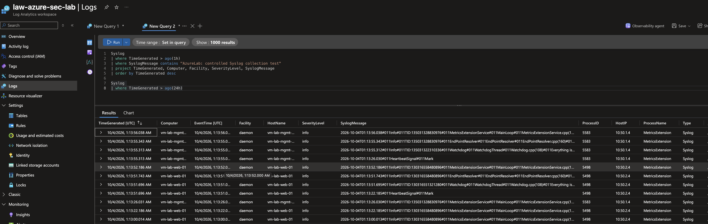

# Initial monitoring: deployment and collection

Evidence supplied October 3, 2026 (America/New_York); rows show October 4 UTC timestamps. Context: Terraform 1.16.4, AzureRM 5.0.0, local Ubuntu execution, Azure Blob workload state. Configuration is in [monitoring.tf](../Terraform/monitoring.tf).

## Configuration and ownership

- Workspace: `law-azure-sec-lab`, PerGB2018, configured retention 30 days and daily quota 1 GB. A daily ingestion cap is not a spending limit and can interrupt collection.
- Subscription diagnostic setting: Administrative Activity Logs sent to this workspace. Collection covers the subscription; lab queries should filter the resource group.
- AMA and Syslog DCR associations target management and web. DCR facilities: auth, authpriv, daemon, syslog; severities Info through Emergency, excluding Debug.
- No performance counters are configured. Syslog messages from the agent's MetricsExtension process do not establish performance-counter collection.
- Nginx access/error file collection and the other three VMs remain pending.

## Deployment troubleshooting

Initial attempts failed because Microsoft.OperationalInsights and Microsoft.Insights were not registered. The author registered the providers and retried with a fresh reviewed plan, preserving partial deployment state.

The supplied successful retry shows **4 added, 0 changed, 0 destroyed**: subscription diagnostic setting, Syslog DCR, and two VM associations. This is the retry's count, not a count of every monitoring resource created across all attempts.



## Verified ingestion and limits

The Heartbeat screenshot contains records from `vm-lab-mgmt-01` and `vm-lab-web-01`. It also displays public IPs and unique identifiers, so it was reviewed but not copied into the repository. For publication, rerun a narrow projection:

```kusto
Heartbeat
| where TimeGenerated > ago(24h)
| summarize LastSeen=max(TimeGenerated) by Computer
```

The retained Syslog screenshot shows daemon/info events from both VMs. It contains a controlled-message query followed by a broader Syslog query, but the displayed results are general events; they do not prove the controlled message was ingested.



## Pending controlled-event investigation

Inside a monitored VM:

```bash
hostname
logger -p authpriv.notice -t AzureLab "controlled-syslog-test-001"
sudo journalctl --since "10 minutes ago" -t AzureLab --no-pager
```

Run the following query separately, allowing ingestion time:

```kusto
Syslog
| where TimeGenerated > ago(1h)
| where SyslogMessage contains "controlled-syslog-test-001"
| project TimeGenerated, Computer, Facility, SeverityLevel, ProcessName, SyslogMessage
| order by TimeGenerated desc
```

The tag may appear in ProcessName rather than SyslogMessage. Local journal evidence alone does not prove rsyslog/AMA forwarding. Check the pipeline before changing collection settings.

Verify subscription log delivery separately:

```kusto
AzureActivity
| where TimeGenerated > ago(24h)
| where ResourceGroup =~ "rg-azure-infra-security-lab"
| project TimeGenerated, OperationNameValue, ActivityStatusValue, ResourceGroup
| order by TimeGenerated desc
| take 20
```

## Next checks

- Retain a sanitized Heartbeat screenshot.
- Investigate and verify the controlled Syslog marker.
- Verify Administrative Activity Logs arrive in AzureActivity.
- Capture a post-monitoring no-changes plan.
- Add Nginx file collection, extend VM monitoring, and then proceed to Sentinel/detection.

For infrastructure edits, run `terraform fmt -check`, `terraform validate`, and `terraform plan -out=lab.tfplan` from Terraform/. Review replacements before apply. Risks: collection gaps, ingestion cost, and evidence/identifier exposure. Preserve backend state; reverting code does not recover deleted logs. No infrastructure was changed while documenting the supplied screenshots.
