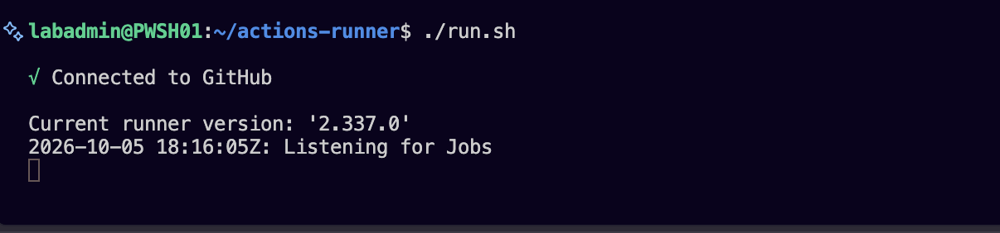
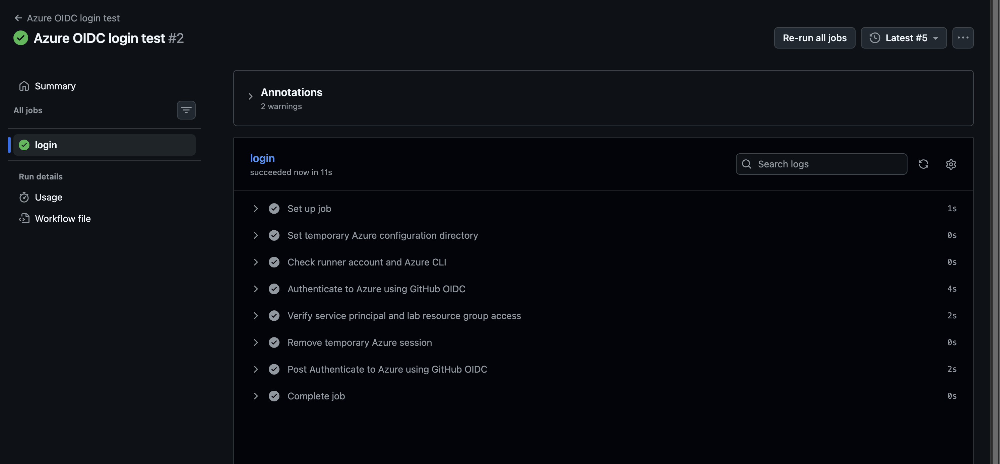
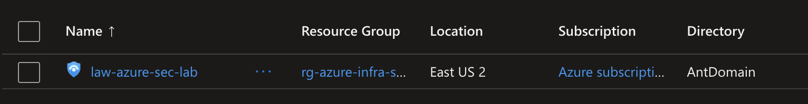

# Private CI/CD runner setup

October 5, 2026. The development repository remains private. The author plans to create a separate sanitized public portfolio repository after completing the lab. The existing runner is for trusted private-repository workflows; public publication and runner registration are separate steps.

## Verified runner registration

The supplied screenshot shows `./run.sh` launched from `~/actions-runner` on Ubuntu under `labadmin`, connected to GitHub, runner version 2.337.0, and **Listening for Jobs** at 18:16:05 UTC. This verifies connection/readiness, not execution of a workflow or Azure access.

The initial screenshot captures an interactive runner. The author subsequently reported moving it to `/home/github-runner/actions-runner`, installing the service as `github-runner`, and confirming service/tool checks. Those later checks have not yet been captured as evidence. Registration credentials and runner working files must never be committed.

## Isolation and identity

The runner initially used the everyday development account. Its reported dedicated account avoids using that account directly, but access to development files still depends on filesystem permissions. OIDC alone does not isolate local files or cached credentials.

Use a separate Entra application/service principal for this lab pipeline; do not reuse or alter the previous Entra automation project's identity. Authenticate using a narrowly scoped GitHub federated credential, not a client secret or the author's interactive Azure login. Verify the repository's actual OIDC subject format before configuring trust.

## Next implementation stages

1. Isolate the runner account and verify required tools/network access under it.
2. Create the dedicated Azure deployment identity and federated trust for this private repository and intended workflow context.
3. Assign workload-scoped permissions and container-scoped Storage Blob Data Contributor for backend access. Ordinary Contributor does not grant role-assignment creation; add only the access needed for actual pipeline resources. Subscription Activity Log export requires separate subscription-level authorization and should remain administrator-managed unless explicitly delegated.
4. Start with a trusted, manually triggered validation/plan workflow. Provide private inputs without committing them, pin tool/action versions, and isolate Azure authentication from personal CLI configuration.
5. Implement a reviewed saved-plan apply with an approval mechanism supported by the repository's GitHub plan. Do not assume private-repository environment reviewer gates are available.
6. Run and capture a successful job, plan review, and approved apply before marking CI/CD complete.

Keep saved plans private and short-lived; they may contain sensitive values. Restrict runner execution to trusted code. Do not execute untrusted pull-request changes on this persistent host. Network access to state storage and identity authorization are independent requirements.

## Initial OIDC test

The author reports creating the Entra federated credential, assigning Azure permissions, and adding `AZURE_CLIENT_ID`, `AZURE_TENANT_ID`, and `AZURE_SUBSCRIPTION_ID` as repository secrets. The storage role screenshot shows inherited access from a parent scope, rather than a container-only assignment.

The workflow [Azure OIDC login test](../.github/workflows/azure-login-test.yml) runs manually on `main` using the Linux x64 self-hosted runner. It checks the dedicated account, authenticates with a pinned Azure Login action, and reads the lab resource group. It uses a temporary Azure CLI configuration and cleans it up. No repository checkout is required.

Push the workflow to `main`, then select **Actions → Azure OIDC login test → Run workflow**, with `main` selected. A successful run verifies authentication and resource-group read access only. State-container access, Terraform plans, subscription diagnostic-setting access, and applies remain unverified. This workflow does not run Terraform; the existing Terraform 1.16.4 / AzureRM 5.0.0 / Azure Blob backend configuration is unchanged.

GitHub OIDC requires `id-token: write`; see [GitHub's Azure OIDC guidance](https://docs.github.com/en/actions/how-tos/secure-your-work/security-harden-deployments/oidc-in-azure). The initial successful test used pinned Azure Login v2. After reviewing its Node.js 20 deprecation warning, the workflow was upgraded to pinned Azure Login v3, which declares Node.js 24. A successful rerun of the upgraded workflow remains pending. See [Azure Login](https://github.com/Azure/login).

## Successful login evidence

On October 5, the supplied screenshot shows **Azure OIDC login test #2**, attempt 5, succeeded in 11 seconds. The dedicated runner-account check, OIDC authentication, service-principal/resource-group check, and cleanup steps succeeded. Two annotations are marked as warnings. The subsequently supplied text identifies a Node.js 20 deprecation warning for Azure Login v2; the other annotation's message was blank in the supplied text and remains unidentified.

The initial login failure was a case-sensitive federated-subject mismatch in the GitHub owner name. Recreating only the credential with the exact subject emitted by GitHub corrected the capitalization. Azure persisted the corrected subject before the successful rerun. The app registration and role assignments were preserved.

This confirms authentication and resource-group read access, not storage data-plane access or infrastructure write permissions. Next verify state-container access, then add Terraform validation and a reviewed plan. No Terraform apply has run through CI.

## Manual Terraform plan workflow

[Terraform validate and plan](../.github/workflows/terraform-plan.yml) is implemented. The author reported a successful run and reviewing the expected Sentinel addition after adding subscription Reader; a final successful plan screenshot remains pending. It only accepts manual runs on `main` in the private repository. It checks the dedicated runner account and installed Terraform version (1.16.4), checks out the selected commit without persistent Git credentials, checks formatting, loads private inputs, logs in through OIDC, checks the existing state blob, initializes with the committed lockfile, validates, and generates a saved plan. AzureRM remains pinned to 5.0.0. Automatic provider registration is disabled; an administrator must register required namespaces, including `Microsoft.SecurityInsights` for Sentinel.

### Before running

Add a repository secret named **TERRAFORM_TFVARS** containing the complete current workload `Terraform/terraform.tfvars` contents, not the sanitized example or bootstrap inputs. Preserve the deployed username, SSH public key, network definitions and other values to avoid unintended changes. Never include an SSH private key or client secret. Do not commit the input file. If using an authenticated GitHub CLI from the repository, `gh secret set TERRAFORM_TFVARS < Terraform/terraform.tfvars` transfers the contents without printing them.

The existing three `AZURE_*` secrets are reused. The runner needs outbound access to GitHub, Azure identity/management endpoints, the provider registry, and the storage blob endpoint. The storage firewall must allow the runner's actual public egress address independently of its Blob Data Contributor role.

The full workload root includes a subscription-level Activity Log diagnostic setting. Lab resource-group Contributor does not cover subscription-scoped reads. If refresh fails with authorization errors, provide the specific read access reported (such as `Microsoft.Insights/diagnosticSettings/read`) through a suitable subscription-scoped read role, or deliberately separate management of that setting in a later reviewed state migration. Do not grant subscription Contributor simply to make a plan pass. Future changes to the subscription setting require additional write authorization; this workflow does not apply them.

### Run and review

Commit and push the workflow to `main`, then select **Actions → Terraform validate and plan → Run workflow → main**. It plans the entire workload root, including Sentinel, rather than targeting one resource. Successful exit code 2 means changes were found; 0 means no changes. Failures remain failures.

Download the run's `terraform-plan-<run-id>-<attempt>` artifact and inspect `plan.txt`. A successful artifact also contains `lab.tfplan` and commit/run provenance. Failed plan output is retained for diagnosis. All of these files are private and expire after one day; plans and diagnostic output may contain sensitive infrastructure data. Repository users with artifact access can read them. Do not publish them in the portfolio repository.

Temporary inputs, backend working files, plan files and the Azure CLI session are removed from the runner after the run. The plan uses state locking and queued workflow concurrency; avoid a simultaneous local apply. No deployment is performed. Review any replacements or deletions before proceeding. Approval and consuming the exact reviewed plan will be implemented separately.

Local checks passed for YAML, embedded Bash syntax, Terraform formatting and Terraform validation. The supplied failed plan log demonstrated state locking and lab-resource refresh, then identified denied subscription-level diagnostic-setting reads. The author subsequently added Reader and reported a successful reviewed plan. A plan may acquire and release a state lease; it is not an infrastructure apply.

## Manual continuous deployment

The `azure-lab` environment was created, but its supplied settings screenshot did not expose Required reviewers. The author chose a separate manual apply workflow without an environment, reusing the verified `main`-branch OIDC trust. No additional federated credential is required. Manual dispatch is the author's explicit deployment authorization, not an independent second-person review gate. Repository users permitted to dispatch workflows can authorize an apply; restrict repository access accordingly.

[Terraform apply reviewed plan](../.github/workflows/terraform-apply.yml) is implemented but has not been executed. It requires the source plan's numeric **run ID**, its **attempt number**, and the exact confirmation **APPLY**. It checks that the source was a successful manual plan workflow on `main` in this private repository, that its commit matches the apply workflow commit and current `main`, and that a single unexpired artifact exists for the selected attempt. It downloads that artifact by ID and verifies the saved plan checksum, Terraform version, provider lockfile checksum and provenance manifest.

The plan workflow now includes `manifest.json` in successful artifacts. Older artifacts do not have this manifest and cannot be applied through the new workflow. After pushing the new workflows and helpers, generate a fresh plan on `main`, download its artifact and review `plan.txt` again. Avoid pushing another commit between review and apply: the commit guard will require a new plan.

To deploy, select **Actions → Terraform apply reviewed plan → Run workflow → main**, enter the reviewed plan run ID from `/actions/runs/<run-id>`, specify its attempt number (usually `1` for a new run), type **APPLY**, and dispatch. The job initializes the existing backend through direct OIDC and runs `terraform apply` on the downloaded `lab.tfplan`. It does not generate a replacement plan or reload `TERRAFORM_TFVARS`; the saved plan already contains the reviewed input values. Supplying a saved plan to Terraform apply authorizes its execution without another interactive prompt.

Plan and apply share queued concurrency and use Azure state locking. Terraform rejects a saved plan if its state has become stale. Artifacts expire after one day, so expired or invalid plans require a new plan and review. A private one-day apply-output artifact contains `apply.txt` for success or failure diagnosis. Both workflows remove temporary files with a bounded retry to handle concurrent directory writes; input files are removed first in the plan workflow.

The pipeline keeps Terraform 1.16.4 and AzureRM 5.0.0 and uses the same Azure Blob backend. Subscription Reader fixes the demonstrated refresh failure but does not permit writing subscription-level diagnostic settings. A reviewed plan that modifies those settings requires deliberately delegated write access before deployment. Contributor at the lab resource group likewise does not grant role-assignment creation. No broader roles were added while implementing CD.

Local validation passed for all workflow YAML, Bash and embedded Python, Terraform formatting/validation, and six offline tests covering valid provenance and rejection of failed runs, forks, wrong branches/commits/workflows/attempts, changed plans and changed lockfiles. No Azure apply was performed during implementation; the author's subsequent manual deployment is verified below. Disabling or removing the apply workflow prevents further workflow deployments but does not undo deployed resources. If an apply fails, inspect its private output and generate a new plan before retrying; Terraform can have completed some changes. Roll back infrastructure through a reviewed corrective configuration and fresh plan rather than reusing an old saved plan.

## Sentinel deployment verified October 6, 2026

GitHub API inspection confirms apply run `37483485943`, attempt `2`, succeeded. Its private output reports Sentinel onboarding creation complete after 21 seconds and **Apply complete! Resources: 1 added, 0 changed, 0 destroyed.** Provenance records plan run `37482650146`, attempt `1`, and commit `5db3733ef0a9d15898e6f94d1b4201d13994f0cd`. The author supplied a portal screenshot showing the workspace listed in Sentinel.

Earlier apply attempts were blocked by a wrong plan attempt/run selection, then Sentinel onboarding failed because `Microsoft.SecurityInsights` was not registered. Following the registration guidance, the author completed deployment. The successful run verifies manual deployment of the reviewed saved plan using the existing branch OIDC identity. A follow-up CI plan reporting no changes remains pending. Sentinel data visibility, detection rules, incidents and response playbooks are separate future checks.

## Automatic plans after merging to main

The plan workflow now also triggers on pushes to `main`, including merged pull requests and direct pushes. Manual dispatch is retained for fresh plans and retries. It executes the committed main configuration on the trusted private-repository runner with the same OIDC identity and pinned Terraform 1.16.4 / AzureRM 5.0.0 configuration. Apply remains manually authorized; no automatic deployment trigger was added.

Readable plan output is included in the run Summary. For automatic runs associated with a merged PR whose merge commit matches the run commit, `scripts/ci/comment_plan.py` posts the plan as a PR comment. The job has `pull-requests: write` for this purpose. Direct pushes without an associated merged PR show the Summary only. Failed plans show available diagnostic output in the Summary; PR comments are posted only for successful plans. Comment publication is best-effort and does not invalidate an otherwise valid saved plan if the comment API fails.

Long output is truncated with instructions to inspect the full private artifact. The saved binary plan and verification manifest remain in the one-day artifact for deployment. Summary and PR comment contents are visible to repository readers and persist independently of the artifact expiry; the private repository restriction remains necessary for these infrastructure details. PR comments occur after merging and do not provide pre-merge validation.

The apply verifier now accepts successful `push` and `workflow_dispatch` source runs while preserving the same main-branch, repository, commit, artifact and checksum checks. Seven offline verifier tests and workflow YAML/Bash/embedded-Python syntax checks passed. A live automatic run and merged-PR comment remain to be verified after these edits are pushed. Remove the `push` trigger to return to manual-only planning; no state or Azure resources were changed while implementing this update.
