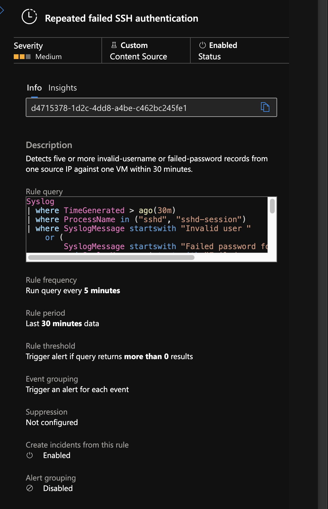
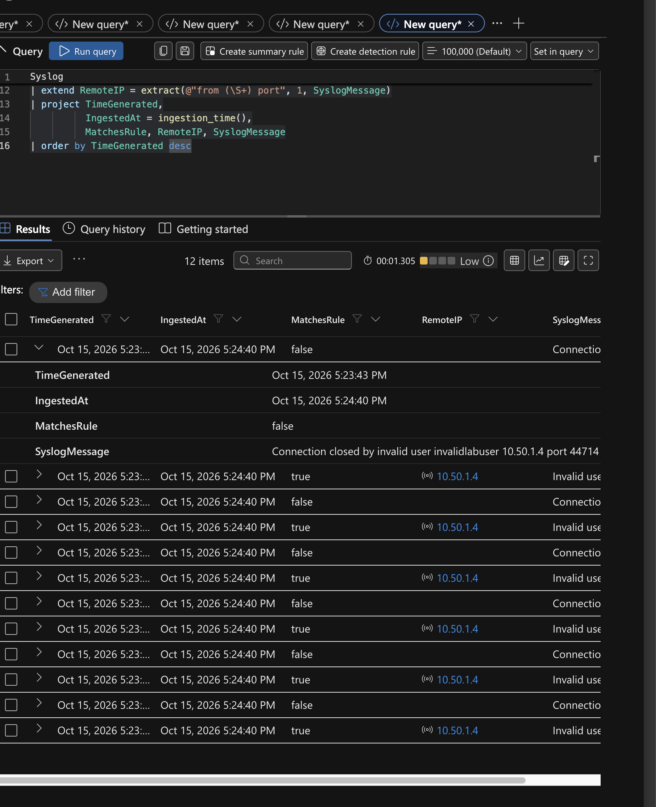
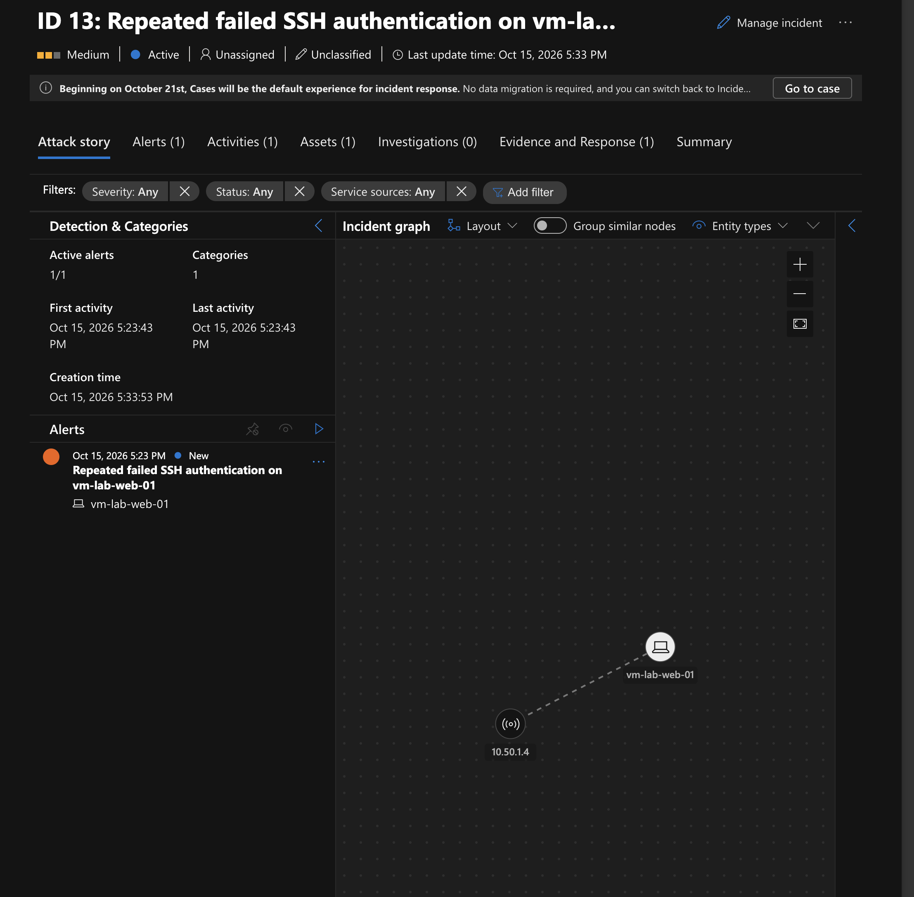
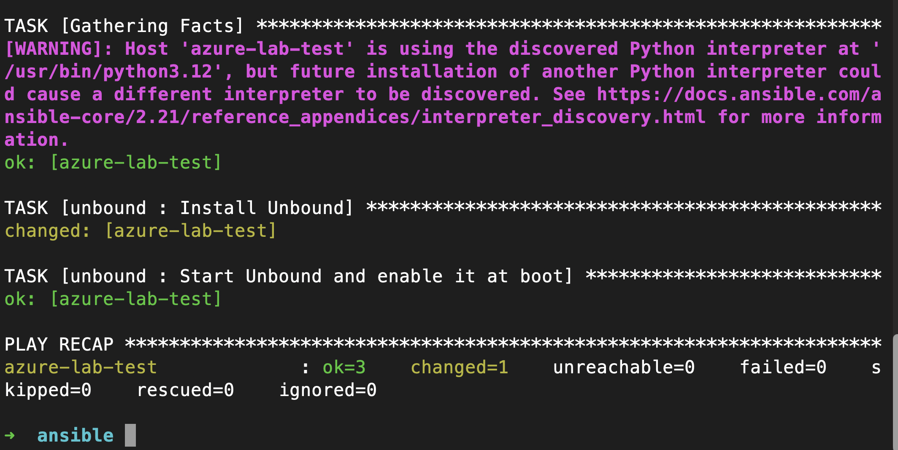
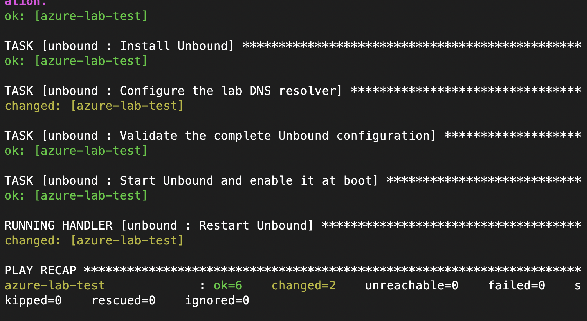
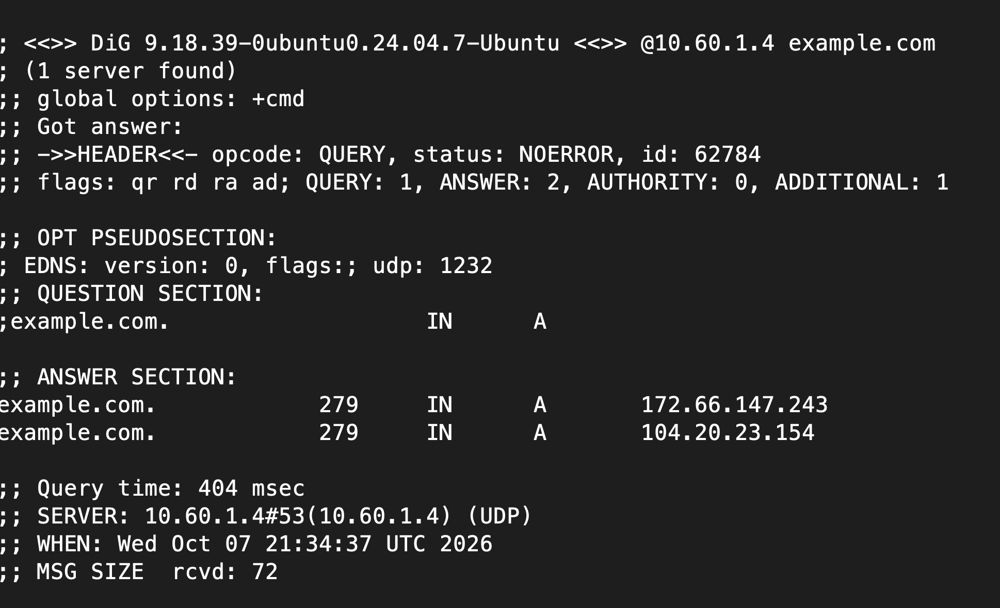
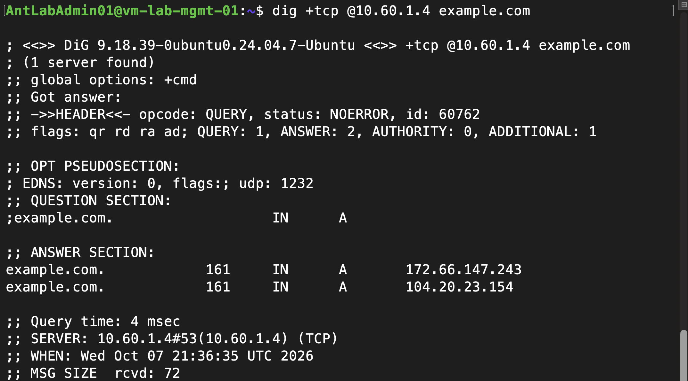
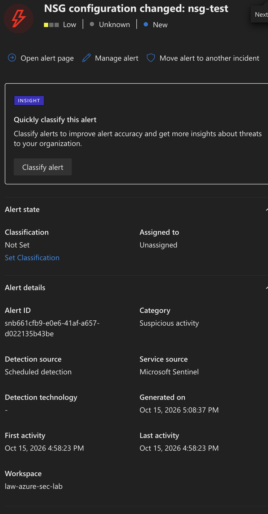

# DNS monitoring and security automation

Validation updated through October 15, 2026. This document records supplied screenshots, author-reported results, and repository configuration separately from unverified behavior.

## Sentinel detections

### NSG configuration changes

The scheduled NSG rule produced an enriched incident for a controlled test NSG change. The supplied incident shows the NSG name, actor identity, operation, event time, correlation ID, affected Azure resource, and custom details. The event is a successful NSG write; it does not include a guaranteed before/after configuration comparison.

The rule runs every five minutes with a 30-minute event lookback and a five-minute ingestion filter. Delayed records older than the lookback can be missed. Event grouping creates an alert per result; incident grouping is disabled. The supplied incident screenshot contains public client and identity details and has not been copied into the publication gallery.

### SSH failures — invalid-user detection verified

The repeated failed SSH authentication rule is deployed and enabled. It combines invalid-user records and failed passwords for valid accounts, grouping counts by host and source IP. It excludes the overlapping `Failed password for invalid user` message so that the invalid-user record is not counted again.



Six invalid-user authentication records from management to web reached Syslog and produced a Defender incident with host/IP entities and an automatically delivered email. The diagnostic query also showed six connection-closed messages; those were not counted by the detection. The password branch is untested because the VMs disable SSH password authentication. Five records are a log-record threshold, not a guaranteed count of unique connections. New failures can produce further alerts in subsequent executions.





The events were ingested at 17:24:40 local time. A later manual query at about 17:32 returned nothing with the five-minute ingestion filter, although matching records existed. The Defender incident was created at about 17:33 and the email arrived at about 17:34. This illustrates why a historical investigation query and scheduled processing window must be evaluated separately. The rule threshold and message matching did not require lowering to make this test work.

Defender incident 13 maps to Sentinel incident 15 for this test. The playbook reads the Sentinel number; the provider incident ID is the Defender number. These were verified through the same incident's API response.

## Unbound deployment

Ansible ran from the Mac control node against the inventory's `test` group using the existing management jump host. A local Unbound role installed the Ubuntu package, configured the service, validated configuration, and restarted through a handler.





Configured behavior:

- Listen on localhost and the test VM private IP `10.60.1.4`, port 53.
- Permit management `10.50.1.4/32`; refuse other nonlocal clients.
- Support UDP and TCP DNS.
- Forward queries to Azure DNS `168.63.129.16` and cache answers.
- Enable `use-syslog: yes` and `log-queries: yes`.

The working role remains on the Mac. **This checkout's `ansible/dns.yml` still contains Nginx tasks; sync the tested DNS playbook and role before presenting this repository as reproducible DNS configuration.**

## DNS connectivity verified

From management:

```bash
dig @10.60.1.4 example.com
dig +tcp @10.60.1.4 example.com
```

Both screenshots show `NOERROR`, two answer records, and the test VM as the responding server. These commands explicitly select the resolver without changing the client's default DNS.





Management's NIC now declares custom DNS `10.60.1.4` in Terraform; other NICs inherit VNet DNS. The deployed change was checked with `resolvectl status`, which showed `10.60.1.4` as the active DNS server. Plain `dig` can show Ubuntu's local `127.0.0.53` stub while forwarding uncached queries to that upstream. The resolver must be running while management depends on it. Successful DNS tests prove effective connectivity, not that explicit DNS-only NSG rules were added.

## Syslog ingestion and parsing

The AMA selection includes management, web, and test. The existing association loop attaches these agents to `dcr-lab-linux-syslog`, collecting auth, authpriv, daemon, and syslog at Info through Emergency. No additional DNS-specific DCR was needed because Unbound writes its query messages through Syslog. The author confirmed a DNS record in Log Analytics:

```text
message repeated 4 times: [ [13077:0] info: 10.50.1.4 example.com. A IN]
```

A query parser extracts the client IP, queried domain, and query type:

```kusto
Syslog
| where TimeGenerated > ago(30m)
| where Computer == "vm-lab-test-01"
| where ProcessName contains "unbound"
| parse SyslogMessage with * "info: " ClientIP:string " " QueriedDomain:string " " QueryType:string " IN" *
| where isnotempty(ClientIP) and isnotempty(QueriedDomain)
| extend QueriedDomain = trim_end(@"\.", tolower(QueriedDomain))
| project TimeGenerated, Computer, ClientIP, QueriedDomain, QueryType, SyslogMessage
| order by TimeGenerated desc
```

`example.com.` is normalized to `example.com`. Repeated-message compression means one row may represent multiple queries; row counts must not be described as exact request counts. DNS proves resolution activity, not a full URL, a site visit, or a particular user. Only clients using the resolver are covered; caching and alternative DNS paths can reduce visibility.

## DNS reputation detection — ingestion and Defender incident verified

The five-minute Logic App query and VirusTotal lookup have been tested. The runtime connector returns verdicts under `body.data.attributes.last_analysis_stats`. The controlled DNS test returned four malicious and five suspicious verdicts. Direct API creation produced Sentinel incident #8, but Microsoft documents that manually/API-created incidents do not synchronize to Defender. The deployed replacement writes flagged results through the ingestion API. HTTP 204, a queryable table row, a Defender alert/incident with domain and IP entities, and automatic email delivery have all been verified.

```text
Unbound → Syslog/AMA → workspace → scheduled Logic App → VirusTotal
                                                        ↓ flagged verdict
                                                DNSReputation_CL
                                                        ↓ Sentinel rule
                                                alert + incident
                                                        ↓ automation rule
                                                email playbook
```

`Terraform/dns-reputation-alerts.tf` defines the Analytics-plan table, endpoint, DCR, and scheduled rule. The endpoint and DCR use the workspace region. `Save_Flagged_Result` sends one JSON record per client IP only when malicious or suspicious counts exceed zero. Original DNS timestamps and the VT analysis epoch are retained. IP and DNS entities and verdict counts are attached to the resulting alert.

### Deployment and verification

1. Format/validate using Terraform 1.16.4 and AzureRM 5.0.0, then create and review a fresh plan through the private runner workflow. No backend migration is required. Expect three ingestion resources and one analytics rule, plus an update to `Check_Domains`; investigate unrelated replacements or deletions before apply.
2. Apply the reviewed plan. Then open **Monitor → Data Collection Rules → dcr-dns-reputation → IAM** and assign **Monitoring Metrics Publisher** to the **dns-rep managed identity** at this DCR scope. This assignment is intentionally managed in the portal: the GitHub deployment identity does not need role-assignment write permission. Keep workspace Log Analytics Reader. The previously assigned Sentinel Responder is no longer needed by this workflow; remove it after verifying migration.
3. Generate a fresh controlled DNS lookup and inspect `Get_Domain_Report`, `Flagged_Domain`, `For_Each_Client`, and `Save_Flagged_Result`. Successful ingestion returns HTTP 204, with no response body. A 403 means the new DCR permission or its propagation must be checked.
4. Verify the saved evidence:

```kql
DNSReputation_CL
| where TimeGenerated > ago(1h)
| project TimeGenerated, Domain, ClientIP, MaliciousCount,
          SuspiciousCount, DNSFirstSeen, DNSLastSeen, VTAnalysisEpoch, WorkflowRunId
| order by TimeGenerated desc
```

5. Check the next scheduled analytics-rule evaluation and confirm an alert/incident in Defender with domain/IP entities and verdict custom details. If Azure has not yet made the new table queryable during rule creation, allow table propagation and use a fresh plan to complete the deployment.

### Limits and next work

The deployed query is restricted to `linkcoll.net` for deterministic testing, and the one-domain-per-run limit remains. Without that exact filter, the limit is not a queue and can skip other results. Broader coverage needs API quota handling, caching, and replay/checkpointing. The five-minute ingestion filter reduces repeat evaluations but is not persistent deduplication. Ingestion retries are deduplicated within a single rule evaluation by domain, IP, and workflow run; cross-run duplicates remain possible. VirusTotal errors/missing reports do not emit flagged records, but require monitoring rather than being treated as clean verdicts. DNS lookups do not prove visits or compromise.

## Shared notification playbook — automatic delivery verified

`incident-email` receives the Sentinel incident trigger, formats an HTML table, and sends it through an authorized personal Outlook.com connection to the privately configured recipient. The recipient is set through `incident_email_recipient` in both private tfvars and the pipeline's `TERRAFORM_TFVARS` secret. No mailbox address is committed in the example.

The automation rule matches any of the DNS, SSH, or NSG analytics-rule IDs through one `IncidentRelatedAnalyticRuleIds` / `Contains` list. It runs on incident creation, not updates or historic incidents. Automatic delivery is verified for all three detections. Email screenshots are excluded from the public-facing gallery because they contain mailbox details.

Permissions are separate: Sentinel Reader on the workspace for the playbook identity; Microsoft Sentinel Automation Contributor on the playbook resource group for Sentinel's Azure Security Insights service identity; and interactive Outlook authorization for sending. The manual playbook test succeeded before automatic invocation was tested.

The NSG rule was restored after the rename/409 recovery, then a controlled `TEST_ALERT` security-rule write produced an alert and automatic email. Investigation details are stored as custom fields while alert descriptions use no more than three placeholders. Custom-detail keys are limited to 20 characters.



Follow-up work is operational: quota-aware VT processing, recovery/checkpointing, cleanup of validation rules, and synchronization of the actual Unbound Ansible role. The core detection-to-email tests are complete.

Rollback: revert the workflow change using a reviewed plan if needed. Removing the custom table deletes its stored evidence; retain the records first and review all planned deletions. Restoring direct incident creation also restores its Defender visibility limitation.

References: [Logs Ingestion API](https://learn.microsoft.com/en-us/azure/azure-monitor/logs/logs-ingestion-api-overview), [API-created incident limitation](https://learn.microsoft.com/en-us/azure/sentinel/create-incident-manually).
